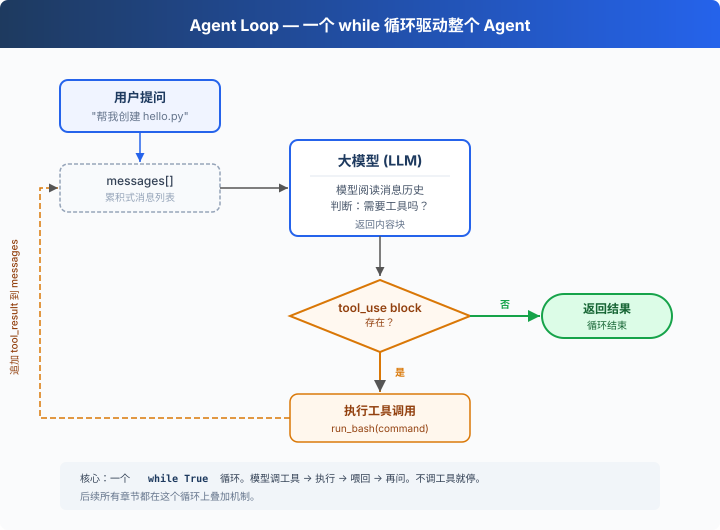

# s01: Agent Loop — 一个循环就够了

> ℹ️ 下面的代码片段摘自同目录 `AgentLoop.java`（有删减，完整可运行版见该文件）。
> Java 版直接用 SDK 的 `MessageCreateParams.Builder` 保存对话历史：每次 `addMessage(...)` 追加一条，
> 每轮 `build()` 出新的请求参数，对应 Python 里不断 `append` 的 `messages` 列表。

`s01` → [s02](../s02_tool_use/) → s03 → s04 → ... → s16 → s17
> *"One loop & Bash is all you need"* — 一个工具 + 一个循环 = 一个 Agent。
>
> **Harness 层**: 循环 — 模型与真实世界的第一道连接。

---

## 问题

你提出了一个问题给大模型：“帮我读取下我的目录下有哪些文件，并且执行XXX.py”。

模型能输出一条 bash 命令，但输出完了就停了，它不会自己跑，也不会看到结果后继续推理。

你可以手动跑一遍，把输出粘贴回对话框，让它接着干。下一个命令出来，你再跑一遍、再贴回去。

每一个来回，你都在做中间层。而把它自动化，就是这一章要做的事。

---

## 解决方案



一个 `while (true)` 循环，模型调用工具就继续，不调用就停。Java 版看响应的 `stop_reason`：

| 信号 | 含义 | 循环动作 |
|------|------|---------|
| `stop_reason == tool_use` | 模型要求调用工具 | 执行 → 结果喂回去 → 继续 |
| 其他 `stop_reason`（如 `end_turn`） | 模型没有调用工具 | 退出循环 |

Python 原版直接检查响应里有没有 `tool_use` block。模型要调用工具时，`stop_reason` 就是 `tool_use`，响应里也一定有 `tool_use` block，两种判断在正常情况下等价。

---

## 工作原理

将这个过程翻译成代码。分步来看：

**第 1 步**：准备好模型、system prompt 和工具定义，把用户的问题作为第一条消息。

```java
MessageCreateParams.Builder paramsBuilder = MessageCreateParams.builder()
        .model(MODEL)
        .system(SYSTEM)
        .maxTokens(8000)
        .addTool(BASH_TOOL);

paramsBuilder.addUserMessage(query);
```

唯一的工具 `bash` 只有一个字符串参数 `command`：

```java
private static final Tool BASH_TOOL = Tool.builder()
        .name("bash")
        .description("Run a shell command.")
        .inputSchema(Tool.InputSchema.builder()
                .properties(JsonValue.from(Map.of(
                        "command", Map.of("type", "string"))))
                .putAdditionalProperty("required", JsonValue.from(List.of("command")))
                .build())
        .build();
```

**第 2 步**：将消息和工具定义一起发给 LLM。

```java
Message response = CLIENT.messages().create(paramsBuilder.build());
```

**第 3 步**：追加模型回答，检查它是否调了工具。没调 → 结束。

```java
paramsBuilder.addMessage(response);   // SDK 会把 Message 转成 assistant 消息

StopReason stop = response.stopReason().orElse(null);
if (stop == null || !stop.equals(StopReason.TOOL_USE)) {
    return response;
}
```

**第 4 步**：执行模型要求的工具，收集结果。

```java
List<ContentBlockParam> results = response.content().stream()
        .flatMap(cb -> cb.toolUse().stream())     // 只取 tool_use block
        .map(AgentLoop::executeToolCall)          // 跑 bash, 包成 tool_result
        .toList();

private static ContentBlockParam executeToolCall(ToolUseBlock block) {
    String output;
    try {
        String command = extractCommand(block);
        output = runBash(command);
    } catch (Exception e) {
        output = "Error: invalid tool input: " + e.getMessage();
    }
    return ContentBlockParam.ofToolResult(ToolResultBlockParam.builder()
            .toolUseId(block.id())
            .content(output)
            .build());
}
```

每个 `tool_result` 都用 `toolUseId` 指回对应的 `tool_use`。模型给的参数不合法时（比如漏了 `command`），错误也作为 `tool_result` 返回，模型下一轮可以修正，程序不会退出。

**第 5 步**：把工具结果作为新消息追加，回到第 2 步。

```java
paramsBuilder.addMessage(MessageParam.builder()
        .role(MessageParam.Role.USER)
        .contentOfBlockParams(results)
        .build());
```

组装为一个完整函数：

```java
private static Message agentLoop(MessageCreateParams.Builder paramsBuilder) {
    while (true) {
        Message response = CLIENT.messages().create(paramsBuilder.build());
        paramsBuilder.addMessage(response);

        // If the model didn't call a tool, we're done
        StopReason stop = response.stopReason().orElse(null);
        if (stop == null || !stop.equals(StopReason.TOOL_USE)) {
            return response;
        }

        // Execute each tool call, collect results
        List<ContentBlockParam> results = response.content().stream()
                .flatMap(cb -> cb.toolUse().stream())
                .map(AgentLoop::executeToolCall)
                .toList();

        // Feed tool results back, loop continues
        paramsBuilder.addMessage(MessageParam.builder()
                .role(MessageParam.Role.USER)
                .contentOfBlockParams(results)
                .build());
    }
}
```

二十多行，这就是最小可运行的 agent harness 内核。它为模型提供持续行动的最小运行框架：模型负责决策（要不要调工具、调哪个），harness 负责执行（调用工具，把结果作为新消息追加）。后面 16 个章节都在这个循环上叠加机制，循环本身始终不变。

---

## 试一下

> **安全提示**：代码会执行模型生成的 shell 命令。建议在一个临时测试目录中运行，避免影响你的项目文件。Java 版的 `runBash` 只拦截了 `rm -rf /`、`sudo`、`shutdown`、`reboot`、`> /dev/` 几个明显危险的写法，s03 会加入真正的权限控制。

**准备**（首次运行）：

```sh
mvn -q compile
cp .env.example .env
# 编辑 .env，填入 ANTHROPIC_API_KEY 和 MODEL_ID
```

**运行**：

```sh
mvn -q compile exec:java -Dexec.mainClass=com.learn.cc.s01_agent_loop.AgentLoop
```

试试这些 prompt：

1. `Create a file called hello.py that prints "Hello, World!"`
2. `List all Python files in this directory`
3. `What is the current git branch?`

观察重点：模型什么时候调用工具（循环继续），什么时候不调用（循环结束）？

---

## 接下来

现在模型手里只有 bash 一个工具，读文件要 `cat`，写文件要 `echo ... >`，找个文件要 `find`，又丑又容易出错。

s02 Tool Use → 给它 5 个真正的工具，会发生什么？模型会不会一次调用多个工具？几个工具同时跑会不会互相踩？

<!-- translation-sync: zh@v1, en@v0, ja@v0 -->
