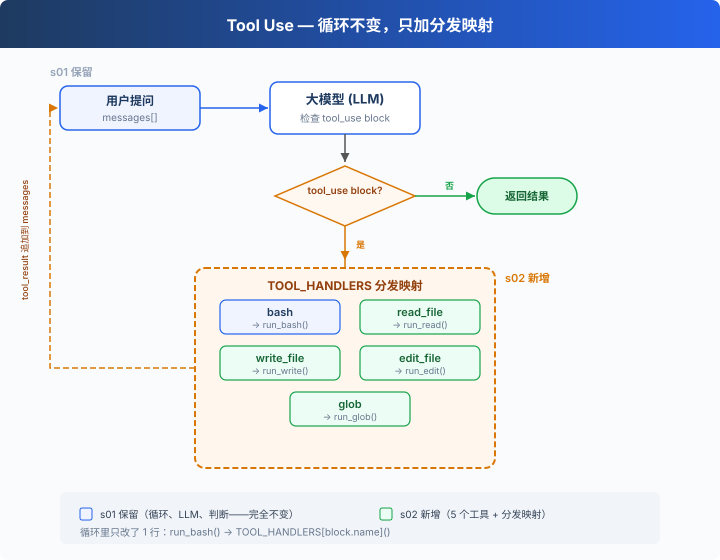

# s02: Tool Use — 多加一个工具，只加一行

> ℹ️ 下面的代码片段摘自同目录 `AgentLoop.java`（有删减，完整可运行版见该文件）。
> Python 用 `TOOL_HANDLERS` 字典查表、`handler(**block.input)` 展开参数；Java 改用 `dispatchTool` 里的 `switch`，
> 参数先转成 `Map<String, Object>`，每个分支自己取值并转换类型。

s01 → `s02` → [s03](../s03_permission/) → s04 → ... → s16 → s17
> *"加一个工具, 只加一个 handler"* — 循环不用动, 新工具注册进 dispatch map 就行。
>
> **Harness 层**: 工具分发 — 扩展模型能触达的边界。

---

## 只有 bash 一个工具

s01 的 Agent 只有一个 bash 工具。读文件要 `cat`，写文件要 `echo "..." > file.py`，改文件要 `sed`。

模型想的是"读这个文件"，却要拼出 `cat path/to/file`。多了一层翻译，浪费 token，还容易拼错。

---

## 全局视角：工具分发



s01 的循环完全保留（LLM 调用、`stop_reason` 判断、消息追加）。唯一的变动在工具执行那一处：`runBash()` 替换为 `dispatchTool(name, input)` 按工具名分发。

给 Agent 加一个工具只需要做两件事：

1. **定义工具**：在 `TOOLS` 列表里加一条描述
2. **注册处理函数**：在 `dispatchTool` 的 `switch` 里加一个 `case`

---

## 从 1 个工具到 5 个工具

s01 只有一个 bash：

```java
private static final Tool BASH_TOOL = Tool.builder().name("bash") /* ... */ .build();

private static String runBash(String command) { /* ... */ }
```

s02 加到 5 个，每个工具都是独立定义：

```java
private static final List<Tool> TOOLS = List.of(
        tool("bash",       "Run a shell command.",
                Map.of("command", Map.of("type", "string")),
                List.of("command")),
        tool("read_file",  "Read file contents.",
                Map.of("path",  Map.of("type", "string"),
                       "limit", Map.of("type", "integer")),
                List.of("path")),
        tool("write_file", "Write content to a file.",
                Map.of("path",    Map.of("type", "string"),
                       "content", Map.of("type", "string")),
                List.of("path", "content")),
        tool("edit_file",  "Replace exact text in a file once.",
                Map.of("path",     Map.of("type", "string"),
                       "old_text", Map.of("type", "string"),
                       "new_text", Map.of("type", "string")),
                List.of("path", "old_text", "new_text")),
        tool("glob",       "Find files matching a glob pattern.",
                Map.of("pattern", Map.of("type", "string")),
                List.of("pattern"))
);

/** 小工具方法, 把 Tool.builder() 那堆样板压缩掉 */
private static Tool tool(String name, String desc, Map<String, ?> props, List<String> required) {
    return Tool.builder()
            .name(name)
            .description(desc)
            .inputSchema(Tool.InputSchema.builder()
                    .properties(JsonValue.from(props))
                    .putAdditionalProperty("required", JsonValue.from(required))
                    .build())
            .build();
}
```

每个工具有自己的实现函数。文件工具都先经过 `safePath`，路径越出工作目录就拒绝：

```java
private static Path safePath(String p) {
    Path resolved = WORKDIR.resolve(p).toAbsolutePath().normalize();
    if (!resolved.startsWith(WORKDIR)) {
        throw new IllegalArgumentException("Path escapes workspace: " + p);
    }
    return resolved;
}

private static String runRead(String path, Integer limit) {
    try {
        List<String> lines = Files.readAllLines(safePath(path));
        if (limit != null && limit < lines.size()) {
            List<String> t = new ArrayList<>(lines.subList(0, limit));
            t.add("... (" + (lines.size() - limit) + " more lines)");
            lines = t;
        }
        return String.join("\n", lines);
    } catch (Exception e) { return "Error: " + e.getMessage(); }
}

private static String runWrite(String path, String content) {
    try {
        Path file = safePath(path);
        if (file.getParent() != null) Files.createDirectories(file.getParent());
        Files.writeString(file, content);
        return "Wrote " + content.length() + " bytes to " + path;
    } catch (Exception e) { return "Error: " + e.getMessage(); }
}

private static String runEdit(String path, String oldText, String newText) {
    try {
        Path file = safePath(path);
        String text = Files.readString(file);
        int idx = text.indexOf(oldText);
        if (idx < 0) return "Error: text not found in " + path;
        Files.writeString(file, text.substring(0, idx) + newText + text.substring(idx + oldText.length()));
        return "Edited " + path;
    } catch (Exception e) { return "Error: " + e.getMessage(); }
}

private static String runGlob(String pattern) {
    try {
        PathMatcher matcher = FileSystems.getDefault().getPathMatcher("glob:" + pattern);
        try (Stream<Path> walk = Files.walk(WORKDIR)) {
            List<String> results = walk.filter(p -> p.startsWith(WORKDIR))
                    .map(WORKDIR::relativize)
                    .filter(rel -> !rel.toString().isEmpty())
                    .filter(matcher::matches)
                    .sorted(Comparator.naturalOrder())
                    .map(Path::toString)
                    .toList();
            return results.isEmpty() ? "(no matches)" : String.join("\n", results);
        }
    } catch (Exception e) { return "Error: " + e.getMessage(); }
}
```

和 Python 原版有几处小差别：`read_file` 截断时会追加一行 `... (N more lines)`，告诉模型还剩多少；`glob` 用的是 Java `PathMatcher` 的语法，`*.py` 只匹配工作目录顶层，`**/*.py` 只匹配子目录里的文件，不包括顶层（Python 的 `recursive=True` 会把顶层也算上）；`glob` 也没有 Python 那个 200 条的上限，模式太宽时会返回很长的列表。

---

## 工具分发

```java
private static String dispatchTool(String name, Map<String, Object> input) {
    return switch (name) {
        case "bash"       -> runBash((String) input.get("command"));
        case "read_file"  -> runRead((String) input.get("path"), asInteger(input.get("limit")));
        case "write_file" -> runWrite((String) input.get("path"), (String) input.get("content"));
        case "edit_file"  -> runEdit((String) input.get("path"),
                                     (String) input.get("old_text"),
                                     (String) input.get("new_text"));
        case "glob"       -> runGlob((String) input.get("pattern"));
        default           -> "Unknown tool: " + name;
    };
}

// 循环里只改了一处——executeToolCall 从硬编码 runBash 变成按名字分发:
private static ContentBlockParam executeToolCall(ToolUseBlock block) {
    String name = block.name();
    Map<String, Object> input = JSON_MAPPER.convertValue(
            block._input(), new TypeReference<Map<String, Object>>() {});
    String output;
    try {
        output = dispatchTool(name, input);
    } catch (Exception e) {
        output = "Error: " + e.getClass().getSimpleName() + ": " + e.getMessage();
    }
    return ContentBlockParam.ofToolResult(ToolResultBlockParam.builder()
            .toolUseId(block.id())
            .content(output)
            .build());
}
```

加一个工具 = 在 `TOOLS` 列表加一条 + 在 `switch` 里加一个 `case`。循环不变。

`switch` 分支里的强制类型转换在模型传错参数时会抛异常（比如漏传 `command` 时 `runBash` 拿到 `null`）。`executeToolCall` 把它接住，作为 `tool_result` 返回，模型下一轮可以修正，程序不会退出。

---

## 多个工具调用

模型经常一次返回多个 tool_use："读一下 a.py 和 b.py，然后列出所有 .py 文件"。

这些调用按照 `response.content` 中的原始顺序逐个执行：`response.content().stream().flatMap(cb -> cb.toolUse().stream()).map(AgentLoop::executeToolCall)` 是顺序流，前一个工具跑完才轮到下一个。

---

## 速查

| 概念 | 一句话 |
|------|--------|
| dispatchTool | 工具名 → 处理函数的 `switch`。加工具 = 加一个 `case` |
| 工具定义 | 告诉模型"我能做什么"的 JSON schema |
| 多工具调用 | 模型可一次返回多个 tool_use，并按原始顺序逐个执行 |
| 循环不变 | s01 的 `while (true)` 循环一行都没改 |

---

## 相对 s01 的变更

| 组件 | 之前 (s01) | 之后 (s02) |
|------|-----------|-----------|
| 工具数量 | 1 (bash) | 5 (+read, write, edit, glob) |
| 工具执行 | 硬编码 `runBash()` | `dispatchTool` 按名字分发 |
| 路径安全 | 无 | `safePath` 校验（仅 file tools） |
| 循环 | `while (true)` + `stop_reason` 判断 | 与 s01 完全一致 |

---

## 试一下

```sh
cd learn-claude-code-java
mvn -q compile exec:java -Dexec.mainClass=com.learn.cc.s02_tool_use.AgentLoop
```

试试这些 prompt：

1. `Read the file README.md and tell me what this project is about`
2. `Create a file called test.py that prints "hello", then read it back`
3. `Find all Python files in this directory`
4. `Read both README.md and pom.xml, then create a summary file`

观察重点：模型什么时候只调一个工具，什么时候一次调多个？多个工具调用的顺序和结果是否正确？

---

## 接下来

现在 Agent 有 5 个专用工具。file tools 受 `safePath` 保护，但 bash 只拦截了几个固定的危险写法，换个写法（比如 `rm -r -f /`）就能绕过去。

s03 Permission → 在工具执行之前加一道门：这个操作安全吗？需要用户批准吗？

<!-- translation-sync: zh@v1, en@v0, ja@v0 -->
