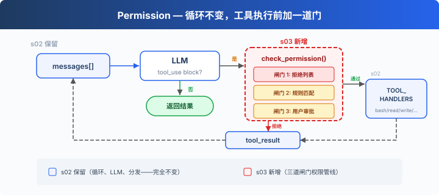
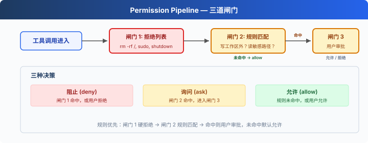

# s03: Permission — 执行前做权限判断

> ℹ️ 下面的代码片段摘自同目录 `AgentLoop.java`（有删减，完整可运行版见该文件）。
> Java 版把闸门 1、2、3 合在一个 `checkPermission` 方法里，规则用 `record Rule(tools, check, message)` 表示，
> `check` 是一个 `Predicate<Map<String, Object>>`，对应 Python 规则字典里的 lambda。

s01 → s02 → `s03` → [s04](../s04_hooks/) → s05 → ... → s16 → s17
> *"工具执行前先做权限判断"* — 权限管线决定哪些操作需要审批。
>
> **Harness 层**: 权限 — 在工具执行前加一道门。

---

## 问题

s02 的 Agent 有 5 个工具。file tools 受 `safePath` 保护，但 bash 只拦截几个固定写法。让它"清理一下项目"，可能执行 `rm -rf /`。

安全边界由代码负责，判断发生在工具执行之前。

---

## 解决方案



s02 的循环完全保留。唯一的变动是在工具执行前插入 `checkPermission()`。每个工具调用依次经过三道闸门：硬拒绝优先，软询问次之，都没命中就放行。

三道闸门对应三种决策：

| 闸门 | 作用 | 命中后 |
|------|------|--------|
| 1. 拒绝列表 | 永远禁止的操作（`rm -rf /`、`sudo`） | 直接拒绝，不执行 |
| 2. 规则匹配 | 取决于上下文的操作（读/写工作区外、`rm` 文件） | 交给闸门 3 |
| 3. 用户审批 | 闸门 2 命中后，暂停等用户确认 | 用户决定允许或拒绝 |

三道都没命中 → 直接执行。大部分日常操作走这条路。

---

## 工作原理



**闸门 1**：一张硬拒绝表，先查，命中就返回阻止信息。这张表使用简单字符串匹配来说明权限闸门的位置，不能视为完整的安全边界。

```java
private static final List<String> DENY_LIST = List.of(
        "rm -rf /", "sudo", "shutdown", "reboot", "mkfs", "dd if=", "> /dev/sda"
);

// checkPermission 开头:
if ("bash".equals(block.name())) {
    String cmd = (String) input.getOrDefault("command", "");
    for (String p : DENY_LIST) {
        if (cmd.contains(p)) {
            System.out.println("\n⛔ Blocked: '" + p + "' is on the deny list");
            return false;
        }
    }
}
```

**闸门 2**负责规则匹配，用来描述"什么时候需要问用户"。每条规则指定工具和检查条件。

```java
private static final Pattern DESTRUCTIVE_COMMAND_WORD =
        Pattern.compile("(?i)(?:^|[;&|()\\n])\\s*(?:rm|del)(?=\\s|$|[;&|()])");

private static boolean containsDestructiveCommand(String command) {
    return DESTRUCTIVE_COMMAND_WORD.matcher(command).find();
}

private record Rule(List<String> tools, Predicate<Map<String, Object>> check, String message) {}

private static final List<Rule> PERMISSION_RULES = List.of(
        new Rule(List.of("read_file", "write_file", "edit_file"),
                args -> {
                    String p = (String) args.getOrDefault("path", "");
                    return !WORKDIR.resolve(p).toAbsolutePath().normalize().startsWith(WORKDIR);
                },
                "Access outside workspace"),
        new Rule(List.of("bash"),
                args -> {
                    String cmd = (String) args.getOrDefault("command", "");
                    return containsDestructiveCommand(cmd)
                            || cmd.contains("rm ") || cmd.contains("> /etc/") || cmd.contains("chmod 777");
                },
                "Potentially destructive command")
);
```

`DESTRUCTIVE_COMMAND_WORD` 识别作为「命令词」出现的 `rm` / `del`：在开头，或者跟在 `;`、`&`、`|`、括号、换行之后，后面是空白、结尾或分隔符，不区分大小写。只靠 `contains("rm ")` 会漏掉 Windows 的 `del` / `DEL`，以及 `ls; rm` 这种 `rm` 后面没有空格的写法。

和 Python 原版的一处差别：Java 版 s03 的文件工具不再自带 `safePath`（代码注释写着「全部交给 Gate 处理」）。所以用户在闸门 3 同意之后，工作区外的路径真的可以读写，不会再被工具自己拦下。

**闸门 2 + 3**：按顺序找第一条命中的规则，命中就暂停等用户输入，只有输入 `y` / `yes` 才放行：

```java
private static boolean checkPermission(ToolUseBlock block, Map<String, Object> input) {
    // 闸门 1: 硬拒绝 (见上)
    // ...

    // 闸门 2 + 3: 规则匹配 → 用户审批
    for (Rule r : PERMISSION_RULES) {
        if (r.tools().contains(block.name()) && r.check().test(input)) {
            System.out.println("\n⚠  " + r.message());
            System.out.println("   Tool: " + block.name() + "(" + input + ")");
            System.out.print("   Allow? [y/N] ");
            String choice = USER_INPUT.hasNextLine() ? USER_INPUT.nextLine().trim().toLowerCase() : "";
            if (!(choice.equals("y") || choice.equals("yes"))) return false;
            break;
        }
    }
    return true;
}
```

**三道闸门插在工具执行之前**。s02 的 `executeToolCall` 换成了 `processToolCall`，只多了一个判断：

```java
private static ContentBlockParam processToolCall(ToolUseBlock block) {
    Map<String, Object> input = JSON_MAPPER.convertValue(
            block._input(), new TypeReference<Map<String, Object>>() {});
    String content;
    try {
        if (!checkPermission(block, input)) {        // ← 新增
            content = "Permission denied.";
        } else {
            content = dispatchTool(block.name(), input);   // s02 原有
        }
    } catch (Exception e) {
        content = "Error: " + e.getClass().getSimpleName() + ": " + e.getMessage();
    }
    return ContentBlockParam.ofToolResult(ToolResultBlockParam.builder()
            .toolUseId(block.id())
            .content(content)
            .build());
}
```

被拒绝的调用也会得到一个 `tool_result`（内容是 `Permission denied.`），每个 `tool_use` 仍然对应一个结果。参数缺失或类型不对时，权限检查和分发里的强制转换会抛异常，`catch` 把它变成错误结果返回，程序不会退出。

---

## 相对 s02 的变更

| 组件 | 之前 (s02) | 之后 (s03) |
|------|-----------|-----------|
| 安全模型 | 无（信任模型） | 三道闸门权限管线 |
| 新函数 | — | `checkPermission`、`containsDestructiveCommand`，以及 `DENY_LIST` / `PERMISSION_RULES` |
| 循环 | 直接执行所有工具 | 执行前插入 `checkPermission()` |

---

## 试一下

```sh
cd learn-claude-code-java
mvn -q compile exec:java -Dexec.mainClass=com.learn.cc.s03_permission.AgentLoop
```

试试这些 prompt：

1. `Create a file called test.txt in the current directory`（应该直接通过）
2. `Delete the file test.txt`（bash + rm 会触发闸门 2）
3. `What files are in the current directory?`（只读，全部通过）
4. `Try to write a file to /etc/something`（写工作区外，触发闸门 2）
5. 在 Windows 上，`del test.txt` 和 `DEL test.txt` 会触发闸门 2，而 `model`、`delimiter` 和 `echo del test.txt` 不会。

观察重点：哪些操作直接通过？哪些需要你确认？哪些被直接拒绝？

---

## 接下来

当前权限检查每次都在循环里硬编码 `checkPermission()`。如果我想在每次工具执行前后加日志？如果想在某些操作后自动触发 git commit？这些扩展逻辑散落在 loop 里，循环很快就会膨胀。

s04 Hooks → 给循环加钩子，扩展逻辑挂在钩子上，循环保持干净。

<!-- translation-sync: zh@v1, en@v1, ja@v1 -->
