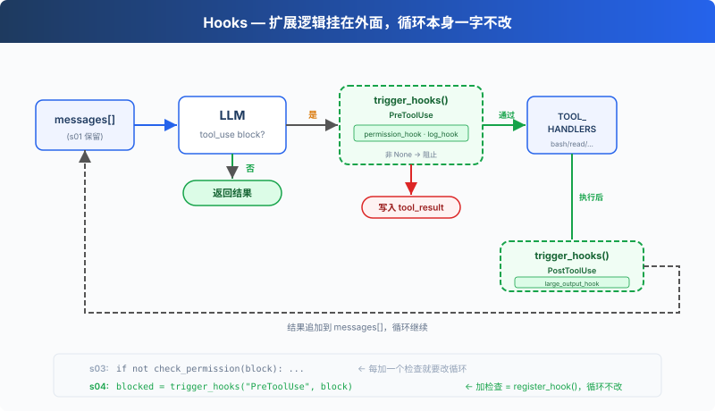

# s04: Hooks — 挂在循环上，不写进循环里

> ℹ️ 下面的代码片段摘自同目录 `AgentLoop.java`（有删减，完整可运行版见该文件）。
> Java 版用 `enum HookEvent` 表示四个事件，回调统一是 `HookCallback extends Function<Object[], String>`：
> 参数以可变参数数组传入（各事件传的参数不同），返回 `null` 表示「不干预」，对应 Python 里返回 `None`。

s01 → s02 → s03 → `s04` → [s05](../s05_todo_write/) → s06 → ... → s16 → s17

> *"挂在循环上, 不写进循环里"* — hook 在工具执行前后注入扩展逻辑。
>
> **Harness 层**: hook — 扩展点不侵入循环。

---

## 问题

s03 的 Agent 有权限检查了。但每次加一个新检查，比如"记录每次 bash 调用"、"操作后自动 git add"，都要修改 `agentLoop` 方法。

循环很快就变成了这样（示意）：

```java
private static ContentBlockParam processToolCall(ToolUseBlock block) {
    logToFile(block);               // 加一行
    checkPermission(block, input);  // 加一行
    notifySlack(block);             // 又加一行
    String output = dispatchTool(block.name(), input);
    autoGitAdd(block);              // 再加一行
    // ... 很快循环就认不出来了
}
```

你想扩展的是 Agent 的行为，但你改的却是循环本身。循环应该是一个稳定的核心，扩展应该挂在外面。

---

## 解决方案



s03 的循环和权限逻辑完全保留。唯一的变动是把 `checkPermission()` 从循环体内移到了 hook 上，循环不再直接调用任何检查函数，改为 `triggerHooks(HookEvent.PRE_TOOL_USE, block, input)`，由注册表决定跑什么。

四个事件，覆盖一个完整的 agent cycle：

| 事件 | 触发时机 | 典型用途 |
|------|---------|---------|
| UserPromptSubmit | 用户输入提交后、进入 LLM 前 | 输入验证、注入上下文 |
| PreToolUse | 工具执行前 | 权限检查、日志记录 |
| PostToolUse | 工具执行后 | 副作用（自动 git add 等）、输出检查 |
| Stop | 循环即将退出时 | 收尾清理、决定是否继续循环 |

扩展通过 `registerHook()` 添加，循环只调用 `triggerHooks()`。

---

## 工作原理

**hook 注册表**：一个 `EnumMap`，事件映射到回调列表。

```java
public enum HookEvent { USER_PROMPT_SUBMIT, PRE_TOOL_USE, POST_TOOL_USE, STOP }
public interface HookCallback extends Function<Object[], String> {}

private static final Map<HookEvent, List<HookCallback>> HOOKS = new EnumMap<>(HookEvent.class);
static { for (HookEvent e : HookEvent.values()) HOOKS.put(e, new ArrayList<>()); }

public static void registerHook(HookEvent event, HookCallback cb) { HOOKS.get(event).add(cb); }

public static String triggerHooks(HookEvent event, Object... args) {
    for (HookCallback cb : HOOKS.get(event)) {
        String r = cb.apply(args);
        if (r != null) return r;   // 返回值 ≠ null → hook 说"停"
    }
    return null;
}
```

`PRE_TOOL_USE` 返回非 `null` 时，本次工具执行被阻止；`STOP` 返回非 `null` 时，循环继续。`USER_PROMPT_SUBMIT` 和 `POST_TOOL_USE` 的返回值不参与控制流。

各事件传给回调的参数：`USER_PROMPT_SUBMIT` 传用户输入的字符串；`PRE_TOOL_USE` 传 `(ToolUseBlock, input Map)`；`POST_TOOL_USE` 再多一个工具输出字符串；`STOP` 不传参数。回调自己按下标取出并强制转换。

**UserPromptSubmit** 在用户输入提交后、进入 LLM 前触发。以下 hook 记录当前工作目录：

```java
private static String contextInjectHook(Object[] args) {
    System.out.println("\033[90m[HOOK] UserPromptSubmit: working in " + WORKDIR + "\033[0m");
    return null;   // null = 不修改, 放行
}

registerHook(HookEvent.USER_PROMPT_SUBMIT, AgentLoop::contextInjectHook);
```

在主循环中，用户输入后立即触发：

```java
String q = USER_INPUT.nextLine().trim();
triggerHooks(HookEvent.USER_PROMPT_SUBMIT, q);   // ← 进入 LLM 之前
paramsBuilder.addUserMessage(q);
Message finalResponse = agentLoop(paramsBuilder);
```

**PreToolUse / PostToolUse**，工具执行前后的 hook。s03 的权限检查逻辑现在包装成 PreToolUse hook，再加一个日志 hook 和一个大输出提醒：

```java
// PreToolUse: 权限检查 (s03 的逻辑, 从循环移到 hook)
private static String permissionHook(Object[] args) {
    ToolUseBlock block = (ToolUseBlock) args[0];
    Map<String, Object> input = (Map<String, Object>) args[1];
    String toolName = block.name();

    if ("bash".equals(toolName)) {
        String cmd = (String) input.getOrDefault("command", "");
        for (String p : DENY_LIST) if (cmd.contains(p)) {
            return "Permission denied by deny list";
        }
        boolean destructive = DESTRUCTIVE_CMD.matcher(cmd).find()
                || DESTRUCTIVE.stream().anyMatch(cmd::contains);
        if (destructive) {
            System.out.print("   Allow? [y/N] ");
            String choice = USER_INPUT.hasNextLine() ? USER_INPUT.nextLine().trim().toLowerCase() : "";
            if (!(choice.equals("y") || choice.equals("yes"))) return "Permission denied by user";
        }
    }
    if (List.of("read_file", "write_file", "edit_file").contains(toolName)) {
        String path = (String) input.getOrDefault("path", "");
        if (!WORKDIR.resolve(path).toAbsolutePath().normalize().startsWith(WORKDIR)) {
            System.out.print("   Allow? [y/N] ");
            String choice = USER_INPUT.hasNextLine() ? USER_INPUT.nextLine().trim().toLowerCase() : "";
            if (!(choice.equals("y") || choice.equals("yes"))) return "Permission denied by user";
        }
    }
    return null;
}

// PreToolUse: 日志
private static String logHook(Object[] args) {
    ToolUseBlock block = (ToolUseBlock) args[0];
    System.out.println("\033[90m[HOOK] " + block.name() + "\033[0m");
    return null;
}

// PostToolUse: 大输出提醒
private static String largeOutputHook(Object[] args) {
    ToolUseBlock block = (ToolUseBlock) args[0];
    String output = (String) args[2];
    if (output.length() > 100_000) {
        System.out.println("\033[33m[HOOK] Large output " + block.name() + ": " + output.length() + " chars\033[0m");
    }
    return null;
}

static {
    registerHook(HookEvent.USER_PROMPT_SUBMIT, AgentLoop::contextInjectHook);
    registerHook(HookEvent.PRE_TOOL_USE, AgentLoop::permissionHook);
    registerHook(HookEvent.PRE_TOOL_USE, AgentLoop::logHook);
    registerHook(HookEvent.POST_TOOL_USE, AgentLoop::largeOutputHook);
    registerHook(HookEvent.STOP, AgentLoop::summaryHook);
}
```

Java 版的 `permissionHook` 把 s03 的两条规则都搬了过来：除了拒绝列表和工作区外路径，bash 命令命中 `DESTRUCTIVE_CMD` 正则（`rm` / `del` 作为命令词）或 `rm `、`> /etc/`、`chmod 777` 时也会询问用户。同一事件注册的 hook 按注册顺序执行，`permissionHook` 在前，所以被拒绝的调用不会再打日志。

**Stop** 在循环即将退出时触发。以下 hook 打印一条收尾日志：

```java
private static String summaryHook(Object[] args) {
    System.out.println("\033[90m[HOOK] Stop: loop exit\033[0m");
    return null;   // null = 允许退出; 返回字符串 = 强制继续
}
```

和 Python 原版的差别：Python 的 `summary_hook` 会拿到 `messages`，统计这次会话一共调用了多少次工具。Java 版的对话历史保存在 `MessageCreateParams.Builder` 里，`STOP` 触发时不传参数，所以只打印一行退出日志。

在 `agentLoop` 中，退出前触发：

```java
StopReason stop = response.stopReason().orElse(null);
if (stop == null || !stop.equals(StopReason.TOOL_USE)) {
    String force = triggerHooks(HookEvent.STOP);   // ← 退出之前
    if (force != null) {
        // hook 返回了一段话 → 作为 user 消息注入, 继续循环
        paramsBuilder.addUserMessage(force);
        continue;
    }
    return response;
}
```

**循环里只改了一处**：s03 直接调用 `checkPermission(block, input)`，s04 改为 `triggerHooks(HookEvent.PRE_TOOL_USE, block, input)`：

```java
private static ContentBlockParam processToolCall(ToolUseBlock block) {
    Map<String, Object> input = JSON_MAPPER.convertValue(
            block._input(), new TypeReference<Map<String, Object>>() {});
    String content;
    try {
        // s03: if (!checkPermission(block, input)) ...
        // s04: hook 替代硬编码
        String blocked = triggerHooks(HookEvent.PRE_TOOL_USE, block, input);
        if (blocked != null) {
            content = blocked;
        } else {
            content = dispatchTool(block.name(), input);
            triggerHooks(HookEvent.POST_TOOL_USE, block, input, content);
        }
    } catch (Exception e) {
        content = "Error: " + e.getClass().getSimpleName() + ": " + e.getMessage();
    }
    return ContentBlockParam.ofToolResult(ToolResultBlockParam.builder()
            .toolUseId(block.id()).content(content).build());
}
```

hook 和分发里的强制类型转换在模型传错参数时会抛异常（比如 `command` 传成数字），`catch` 把它变成错误 `tool_result` 返回，程序不会退出。

四个 hook 覆盖了 agent cycle 的关键节点：输入→执行前→执行后→退出。循环只负责调用 `triggerHooks()`，具体逻辑全在 hook 回调里。

---

## 相对 s03 的变更

| 组件 | 之前 (s03) | 之后 (s04) |
|------|-----------|-----------|
| 扩展方式 | `checkPermission()` 硬编码在循环里 | `HOOKS` 注册表 + `triggerHooks()` |
| 新方法 | — | `registerHook`, `triggerHooks` |
| hook 回调 | — | `contextInjectHook`, `permissionHook`, `logHook`, `largeOutputHook`, `summaryHook` |
| 循环 | 直接调用 `checkPermission()` | 调用 `triggerHooks(HookEvent.PRE_TOOL_USE, ...)` |
| 退出控制 | 无 | `triggerHooks(HookEvent.STOP)` 可阻止退出 |
| 输入拦截 | 无 | `triggerHooks(HookEvent.USER_PROMPT_SUBMIT, ...)` 可注入上下文 |

---

## 试一下

```sh
cd learn-claude-code-java
mvn -q compile exec:java -Dexec.mainClass=com.learn.cc.s04_hooks.AgentLoop
```

试试这些 prompt：

1. `Read the file README.md`（应该直接通过，观察 hook 日志）
2. `Create a file called test.txt`（通过后观察 PostToolUse 是否触发）
3. `Delete all temporary files in /tmp`（bash + rm 触发权限 hook）

观察重点：每次工具执行前，是否出现了 `[HOOK]` 日志？权限被拒时，是 hook 拦截的还是循环里硬编码的？

---

## 接下来

Agent 现在能安全执行操作了。但它有没有停下来想过"我应该先做什么，再做什么"？给它一个复杂任务，它是一上来就动手，还是先列个计划？

s05 TodoWrite → 给 Agent 一个计划工具。先列清单，再做。

<!-- translation-sync: zh@v1, en@v0, ja@v0 -->
