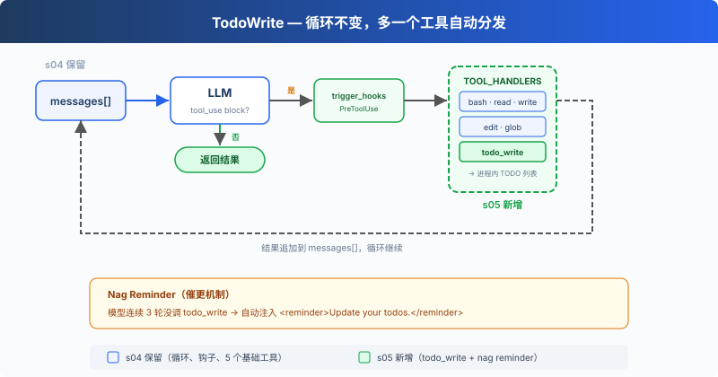

# s05: TodoWrite — 没有计划的 Agent，做着做着就偏了

> ℹ️ 下面的代码片段摘自同目录 `AgentLoop.java`（有删减，完整可运行版见该文件）。
> Python 用一个 `TodoManager` 类保存清单；Java 版没有单独的类，用静态的 `List<TodoItem> TODOS`
> 加 `updateTodos` / `renderTodos` 两个方法，每一项是 `record TodoItem(content, status)`，状态是 `enum TodoStatus`。

s01 → s02 → s03 → s04 → `s05` → [s06](../s06_subagent/) → s07 → ... → s16 → s17

> *"没有计划的 agent 走哪算哪"* — 先列步骤再动手，长任务更不容易漏项。
>
> **Harness 层**: 规划 — 让 Agent 在动手之前先想清楚。

---

## 问题

给 Agent 一个复杂任务："把所有 Python 文件改成 snake_case 命名，然后跑测试，修好失败。"

Agent 开始干活，改了 3 个文件，跑了个测试，发现 2 个失败，开始修。修着修着，它忘了最初是"改成 snake_case"，测试失败把注意力全吸走了。

对话越长越严重：工具结果不断填满上下文，系统提示的影响力被稀释。一个 10 步重构，做完 1-3 步就开始即兴发挥，因为 4-10 步已经被挤出注意力了。

---

## 解决方案



S05 保留 S04 的工具分发、权限检查和 hook 注册表，再加入 `todo_write` 与 reminder 计数器。`todo_write` 只更新计划状态，实际工作仍由原有工具完成。（Java 版 s05 只注册了 `PRE_TOOL_USE` 上的 `permissionHook`，s04 的日志、大输出提醒、UserPromptSubmit 和 Stop 示例 hook 没有带过来。）

新工具仍通过 `dispatchTool` 的 `switch` 分发。连续三个工具调用轮次没有使用 `todo_write` 时，Harness 会把 reminder 追加到第三轮的工具结果中。

---

## 工作原理

**Todo 清单**保存在内存里，`updateTodos` 负责校验更新，`renderTodos` 把清单渲染成文本返回给模型。`runTodoWrite` 同时把这份状态打印到终端：

```java
public enum TodoStatus { PENDING, IN_PROGRESS, COMPLETED }
public record TodoItem(String content, TodoStatus status) {}
private static final List<TodoItem> TODOS = new ArrayList<>();

private static String updateTodos(List<?> raw) {
    if (raw == null) throw new IllegalArgumentException("todos must be a list");
    if (raw.size() > 20) throw new IllegalArgumentException("Max 20 todos allowed");
    List<TodoItem> vs = new ArrayList<>();
    int inProg = 0;
    for (int i = 0; i < raw.size(); i++) {
        if (!(raw.get(i) instanceof Map<?, ?> m))
            throw new IllegalArgumentException("todos[" + i + "] must be an object");
        String content = String.valueOf(m.get("content")).trim();
        String s = String.valueOf(m.get("status")).toLowerCase();
        if (content.isEmpty() || "null".equals(content))
            throw new IllegalArgumentException("todos[" + i + "] requires content");
        TodoStatus st = switch (s) {
            case "pending"     -> TodoStatus.PENDING;
            case "in_progress" -> TodoStatus.IN_PROGRESS;
            case "completed"   -> TodoStatus.COMPLETED;
            default -> throw new IllegalArgumentException("todos[" + i + "] invalid status: " + s);
        };
        if (st == TodoStatus.IN_PROGRESS) inProg++;
        vs.add(new TodoItem(content, st));
    }
    if (inProg > 1) throw new IllegalArgumentException("Only one in_progress allowed");
    TODOS.clear(); TODOS.addAll(vs);      // 全部校验通过才整表替换
    return renderTodos();
}

private static String renderTodos() {
    // [ ] pending, [>] in progress, [x] completed, 末尾附 "(done/total completed)"
    // ...
}

private static String runTodoWrite(Object arg) {
    try {
        // 模型偶尔会把数组序列化成 JSON 字符串传进来; 先按 JSON 数组解析
        if (arg instanceof String str) {
            try { arg = JSON_MAPPER.readValue(str, new TypeReference<List<Object>>() {}); }
            catch (Exception e) { return "Error: todos must be a list (string input must be a JSON array)"; }
        }
        if (!(arg instanceof List<?> l)) return "Error: todos must be a list";
        String out = updateTodos(l);
        System.out.println("\n## Current Tasks\n" + out);
        return out;
    } catch (IllegalArgumentException e) {
        return "Error: " + e.getMessage();
    }
}
```

一次更新最多包含 20 项；每项都必须有非空的 `content`；同一时间只能有一个 `in_progress`。任何一项不合法，整次更新都会被拒绝，原来的清单保持不变。字符串输入必须是 JSON 数组；Python 原版还接受 Python 列表写法（如 `[{'content': ...}]`），Java 版不支持。

工具定义和其他 5 个工具一起加入 `TOOLS`，分发处多一个 `case`：

```java
private static final List<Tool> TOOLS = List.of(
        tool("bash", ...),
        tool("read_file", ...),
        tool("write_file", ...),
        tool("edit_file", ...),
        tool("glob", ...),
        // s05: 新增一条
        Tool.builder()
                .name("todo_write")
                .description("Create and manage a task list for your current coding session.")
                .inputSchema(Tool.InputSchema.builder()
                        .properties(JsonValue.from(Map.of(
                                "todos", Map.of(
                                        "type", "array",
                                        "maxItems", 20,
                                        "items", Map.of(
                                                "type", "object",
                                                "properties", Map.of(
                                                        "content", Map.of("type", "string", "minLength", 1),
                                                        "status", Map.of("type", "string",
                                                                "enum", List.of("pending", "in_progress", "completed"))
                                                ),
                                                "required", List.of("content", "status")
                                        )
                                )
                        )))
                        .putAdditionalProperty("required", JsonValue.from(List.of("todos")))
                        .build())
                .build()
);

// dispatchTool 里:
case "todo_write" -> runTodoWrite(input.get("todos"));
```

**Reminder**：连续三个工具调用轮次没有使用 `todo_write` 时，reminder 会追加到第三轮的结果中，随后计数器清零：

```java
private static final int REMINDER_ROUNDS = 3;

// agentLoop 里, 每轮执行完工具后:
boolean[] usedTodoRef = {false};
List<ContentBlockParam> results = new ArrayList<>(response.content().stream()
        .flatMap(cb -> cb.toolUse().stream())
        .map(b -> {
            if ("todo_write".equals(b.name())) usedTodoRef[0] = true;
            return processToolCall(b);
        })
        .toList());

roundsSinceTodo = usedTodoRef[0] ? 0 : roundsSinceTodo + 1;
if (roundsSinceTodo >= REMINDER_ROUNDS) {
    results.add(ContentBlockParam.ofText(TextBlockParam.builder()
            .text("<reminder>Update your todos.</reminder>").build()));
    roundsSinceTodo = 0;
}
```

lambda 里不能修改外层的局部变量，所以用一个长度为 1 的 `boolean[]` 记录「这一轮有没有调用 `todo_write`」。reminder 是一个 text block，和这一轮的 `tool_result` 放在同一条 user 消息里。`roundsSinceTodo` 是 `agentLoop` 的局部变量，用户每发一条新消息都会从 0 重新计数。

Agent 收到任务后的典型流程：先调 `todo_write` 列出所有步骤（全 `pending`）→ 做一个步骤，改成 `in_progress` → 做完改成 `completed` → 看下一个 `pending` → 继续。

**关键洞察**：todo_write 不给 Agent 增加任何**执行能力**。它增加的是**规划能力**。

---

## 相对 s04 的变更

| 组件 | 之前 (s04) | 之后 (s05) |
|------|-----------|-----------|
| 工具数量 | 5 (bash, read, write, edit, glob) | 6 (+todo_write) |
| 规划能力 | 无 | 带状态的 TODO 列表 + reminder |
| SYSTEM 提示 | 通用提示 | 加入 "先计划再执行" 引导 |
| 循环 | 工具分发与 Hooks | 保留分发路径，加入 `roundsSinceTodo` 和 reminder 注入 |

---

## 试一下

```sh
cd learn-claude-code-java
mvn -q compile exec:java -Dexec.mainClass=com.learn.cc.s05_todo_write.AgentLoop
```

试试这些 prompt：

1. `Refactor src/main/java/com/learn/cc/s05_todo_write/example/hello.py: add type hints, docstrings, and a main guard`（先列 3 步再执行）
2. `Create a Python package under src/main/java/com/learn/cc/s05_todo_write/example/demo_pkg with __init__.py, utils.py, and tests/test_utils.py`
3. `Review Python files under src/main/java/com/learn/cc/s05_todo_write/example and fix any style issues`

（从仓库根目录运行时，工作目录就是仓库根目录，所以示例文件要写完整路径。）

观察重点：第一次工具调用是不是 `todo_write`？TODO 列了几步？执行过程中状态有没有从 `pending` 变成 `in_progress` / `completed`？

---

## 接下来

Agent 能计划了。但如果一个任务太大，比如"重构整个认证模块"，光靠 TODO 列表不够。这个任务本身就是几十个小任务的集合，放在同一个对话里会被上下文淹没。

s06 Subagent → 把大任务拆成子任务，每个子任务派一个独立的 Agent。它们有自己的干净上下文，不会互相污染。

<!-- translation-sync: zh@v1, en@v1, ja@v1 -->
