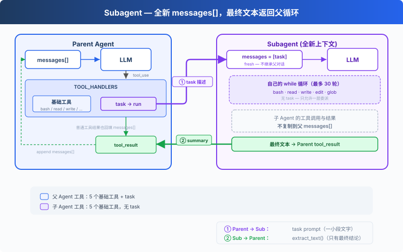

# s06: Subagent — 给子任务一段独立上下文

> ℹ️ 下面的代码片段摘自同目录 `AgentLoop.java`（有删减，完整可运行版见该文件）。
> 子 Agent 的「全新 `messages[]`」在 Java 里是一个新的 `MessageCreateParams.Builder`：只放入 prompt，
> 后续消息都追加在这个 builder 上，和父 Agent 的 builder 互不相干。

s01 → s02 → s03 → s04 → s05 → `s06` → [s07](../s07_skill_loading/) → s08 → ... → s16 → s17

> Subagent 从全新的 `messages[]` 开始。最终文本返回父循环，中间对话不会进入父上下文。
>
> **Harness 层**: 委派 — 在另一段对话上下文中处理一个明确的子任务。

---

## 问题

Agent 在修一个 bug。为了追踪调用链，它读取了许多文件；每次工具调用和结果都会留在父循环的 `messages[]` 中。调用链已经弄清以后，多数中间细节不再需要，却仍然占用上下文。

---

## 解决方案



调用 `task` 时，会同步运行一个使用全新 `messages[]` 的嵌套 Agent Loop。循环结束后，它的最终文本会成为父对话中的工具结果。

这里隔离的是消息，不是进程或文件系统。父 Agent 与子 Agent 共享 `WORKDIR`，写文件和命令仍会影响同一个工作区。子 Agent 拥有五个基础工具，但没有 `task`；它的工具调用与父 Agent 经过同一组 `PRE_TOOL_USE` hook。（Java 版 s06 只注册了 `permissionHook`，而且只检查 bash：拒绝列表加破坏性命令确认，不检查文件工具的路径。）

---

## 工作原理

**runSubagent** 创建新的消息 builder，运行嵌套循环，并返回最终文本：

```java
private static final int SUB_MAX_TURNS = 30;

private static String runSubagent(String prompt) {
    MessageCreateParams.Builder sub = MessageCreateParams.builder()
            .model(MODEL).system(SUB_SYSTEM).maxTokens(8000).temperature(0.3)
            .addUserMessage(prompt);                 // 全新的对话, 只有这一条 prompt
    BASE_TOOLS.forEach(sub::addTool);                // 只给 5 个基础工具, 没有 task

    String lastText = "";
    for (int turn = 0; turn < SUB_MAX_TURNS; turn++) {
        Message resp = CLIENT.messages().create(sub.build());
        sub.addMessage(resp);
        String t = /* resp 里的全部 text */;
        if (!t.isEmpty()) lastText = t;

        StopReason stop = resp.stopReason().orElse(null);
        if (stop == null || !stop.equals(StopReason.TOOL_USE)) {
            return lastText.isEmpty() ? "(no summary)" : lastText;
        }

        List<ContentBlockParam> results = resp.content().stream()
                .flatMap(cb -> cb.toolUse().stream())
                .map(AgentLoop::processSubToolCall)
                .toList();
        sub.addMessage(MessageParam.builder()
                .role(MessageParam.Role.USER).contentOfBlockParams(results).build());
    }
    return "Subagent stopped after " + SUB_MAX_TURNS + " turns.";
}

private static ContentBlockParam processSubToolCall(ToolUseBlock block) {
    Map<String, Object> input = /* block._input() 转成 Map */;
    String out;
    try {
        if ("task".equals(block.name())) {
            out = "Unknown tool: task";              // 只允许一层委派
        } else {
            String blocked = triggerHooks(HookEvent.PRE_TOOL_USE, block, input);
            out = (blocked != null) ? blocked : dispatchTool(block.name(), input);
        }
    } catch (Exception e) {
        out = "Error: " + e.getClass().getSimpleName() + ": " + e.getMessage();
    }
    return ContentBlockParam.ofToolResult(ToolResultBlockParam.builder()
            .toolUseId(block.id()).content(out).build());
}
```

父子 Agent 共用同一个 `dispatchTool`，里面有 `case "task"`。子 Agent 的工具列表里虽然没有 `task`，但如果模型仍然发出 `task` 调用，不拦截的话就会再起一个孙 Agent，所以 `processSubToolCall` 先把它挡掉。Python 原版的子 Agent 用的是不含 `task` 的 `SUB_HANDLERS`，效果相同。

和 Python 原版的一处小差别：子 Agent 结束时，Java 返回的是**最后一次出现的非空文本**；最后一轮没有文本时，会退回到更早一轮说过的话，而不是直接返回 `(no summary)`。

主 Agent 调用时，跟调其他工具一样：

```java
private static final Tool TASK_TOOL = Tool.builder()
        .name("task")
        .description("Run a subagent with fresh conversation context and return its final text.")
        .inputSchema(Tool.InputSchema.builder()
                .properties(JsonValue.from(Map.of(
                        "prompt", Map.of("type", "string", "minLength", 1))))
                .putAdditionalProperty("required", JsonValue.from(List.of("prompt")))
                .build())
        .build();

private static final List<Tool> PARENT_TOOLS;     // BASE_TOOLS + TASK_TOOL
static {
    List<Tool> pt = new ArrayList<>(BASE_TOOLS);
    pt.add(TASK_TOOL);
    PARENT_TOOLS = List.copyOf(pt);
}

// dispatchTool 里:
case "task" -> runSubagent((String) input.get("prompt"));
```

父 Agent 的 `processToolCall` 同样用 `try/catch` 包住分发。子 Agent 调用模型失败时（比如 API 返回错误）抛出的异常会在这里变成一条错误 `tool_result`，父 Agent 继续运行，程序不会退出。

实际边界如下：

| 决策 | 选择 | 原因 |
|------|------|------|
| 对话 | 全新的 `messages[]` | 不把父对话复制给子 Agent |
| 执行 | 同一进程和 `WORKDIR` | 两个循环都能看到文件系统修改 |
| 返回值 | 只返回最终文本 | 子 Agent 的工具调用和结果不进入父消息列表 |
| 委派深度 | 子 Agent 只拿到 `BASE_TOOLS`，`processSubToolCall` 拒绝 `task` | 本章只允许一层委派 |
| 工具策略 | 共享 Hooks | 父子循环使用相同的权限检查 |

父 Agent 与其他工具一样，通过 `dispatchTool` 的 `switch` 分发 `task`。子 Agent 使用 `SUB_SYSTEM`、`BASE_TOOLS` 和自己的 `MessageCreateParams.Builder`。

---

## 试一下

```sh
cd learn-claude-code-java
mvn -q compile exec:java -Dexec.mainClass=com.learn.cc.s06_subagent.AgentLoop
```

试试这些 prompt：

1. `Use a subtask to find what testing framework this project uses`（子 Agent 去读文件，主 Agent 只收结论）
2. `Delegate: read the AgentLoop.java files under src/main/java/com/learn/cc/s0[1-5]* and summarize what each chapter adds`
3. `Use a task to create src/main/java/com/learn/cc/s06_subagent/example/string_tools.py with a slugify(text: str) function, then verify it from the parent agent`

观察重点：是否出现 `[Subagent started]` / `[Subagent done]`？子 Agent 的工具调用是否以 `[sub] ...` 输出？父 Agent 是否只接收到 `task` 返回的最终文本？

---

## 接下来

Agent 现在能拆任务了。但每个任务需要的知识不一样：改前端组件需要知道 React 规范，写 SQL 需要知道表结构。这些知识全塞进 system prompt，上下文直接爆了。

s07 Skill Loading → 技能按需注入，不在 system prompt 里堆文档。用到的时候才加载，和读文件一样自然。

<!-- translation-sync: zh@v2, en@v2, ja@v2 -->
