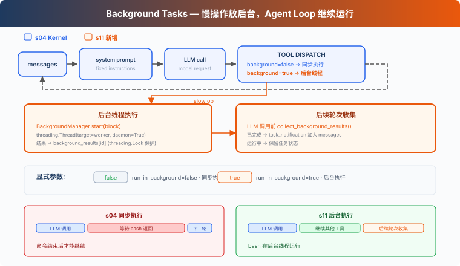

# s11: Background Tasks — 慢操作放后台

> ℹ️ 下面的代码片段摘自同目录 `AgentLoop.java`（有删减，完整可运行版见该文件）。
> Java 版用 `Thread`（daemon）+ `ReentrantLock` 实现后台执行，子进程清理用 Java 9+ 的 `ProcessHandle` API，
> 而不是 Python 原版的进程组 + `SIGTERM`。

s01 → ... → s09 → s10 → `s11` → [s12](../s12_cron_scheduler/) → s13 → ... → s16 → s17

> *"慢操作放后台，Agent Loop 继续运行"* — 后台线程执行命令，后续轮次收集完成结果。
>
> **Harness 层**: 后台 — 异步执行, 不阻塞主循环。

---

## 问题

读取文件或运行 `git status` 通常很快，同步执行时等待并不明显。但安装依赖、执行完整测试或构建项目可能持续几分钟。在命令返回前，Harness 无法处理当前响应中的下一个工具调用，也不能进入下一轮。

如果后续工作并不依赖这个命令，继续等待就没有必要。例如，Agent 启动完整测试后，本来还可以检查文档或整理其他文件，但同步执行会让整个 Agent Loop 停在这次 Bash 调用上。

S11 要解决的问题是：让耗时的 Bash 命令在后台执行，使 Agent Loop 可以继续处理其他工作，并在后续轮次收集完成结果。

---

## 解决方案



本章把慢操作放入后台线程。当前工具调用先返回一个占位 `tool_result`，Agent Loop 可以继续运行；后续轮次开始时再收集已经完成的结果，以通知形式加入对话。

同步 vs 后台：

| | 同步 (s04) | 后台 (s11) |
|---|---|---|
| 慢操作 | 当前工具调用被阻塞 | 后台线程执行 |
| Agent Loop | 等待命令返回 | 收到占位结果后继续运行 |
| 结果 | 命令结束后返回 | 先返回 `bg_id`，后续轮次收集结果 |
| 判断标准 | — | bash 的 `run_in_background` 参数 |

---

## 工作原理

### shouldRunBackground: 显式请求

模型通过 bash 工具的 `run_in_background` 参数请求后台执行。只有参数明确为 `true`，并且工具是 bash 时，才会进入后台执行路径。其他调用仍然同步执行。

```java
private static boolean shouldRunBackground(String toolName, Map<String, Object> input) {
    return "bash".equals(toolName) && Boolean.TRUE.equals(input.get("run_in_background"));
}
```

bash 的 schema 也相应多了一个布尔参数：

```java
tool("bash", "Run a shell command.",
        Map.of("command", Map.of("type", "string"),
               "run_in_background", Map.of("type", "boolean")),
        List.of("command")),
```

不再根据 `install`、`build` 或 `test` 等关键词猜测。是否进入后台由工具调用明确决定。

### BackgroundManager: 后台执行与生命周期

`BackgroundManager` 保存任务状态和完成队列。`start()` 先在锁内登记任务、分配递增的 `bg_0001` 式 ID，再启动 daemon 线程，并立即返回 ID：

```java
static final class BackgroundManager {
    private final Map<String, BgTask> tasks = new LinkedHashMap<>();    // id → 命令 / 状态
    private final Map<String, String> results = new LinkedHashMap<>();  // id → 格式化后的输出
    private final List<String> ready = new ArrayList<>();               // 新完成、待收集的 id
    private int counter = 0;
    private final ReentrantLock lock = new ReentrantLock();

    String start(ToolUseBlock block, String command) {
        if (command == null || command.strip().isEmpty()) {
            throw new IllegalArgumentException("Bash command cannot be empty");
        }
        String taskId;
        lock.lock();
        try {
            counter++;
            taskId = String.format("bg_%04d", counter);
            tasks.put(taskId, new BgTask(block.id(), command));
        } finally { lock.unlock(); }

        Thread t = new Thread(() -> runInBackground(taskId, command), "bg-" + taskId);
        t.setDaemon(true);   // daemon 线程: 主程序退出时不阻拦
        t.start();
        return taskId;
    }

    private void runInBackground(String taskId, String command) {
        String result;
        String status;
        try {
            BashResult br = runBashProcess(command);
            result = formatBashResult(br);
            status = (br.exitCode() != null && br.exitCode() == 0) ? "completed" : "failed";
        } catch (Exception e) {
            result = "Error: " + e.getClass().getSimpleName() + ": " + e.getMessage();
            status = "failed";
        }
        lock.lock();
        try {
            BgTask t = tasks.get(taskId);
            if (t == null) return;
            t.status = status;
            results.put(taskId, result);
            ready.add(taskId);
        } finally { lock.unlock(); }
    }
}
```

命令以非零状态退出、超时（`exitCode` 为 `null`），或 worker 抛出异常时，任务会进入 `failed`。

前台和后台共用 `runBashProcess`。它把每个活跃的 `Process` 记进 `LIVE_PROCESSES`，`finally` 里移除并做一次清理；JVM 退出时，shutdown hook 对仍在运行的 shell 先杀子孙进程、再杀 shell 本身：

```java
private static final Set<Process> LIVE_PROCESSES = Collections.synchronizedSet(new LinkedHashSet<>());

static {
    Runtime.getRuntime().addShutdownHook(new Thread(() -> {
        synchronized (LIVE_PROCESSES) {
            for (Process p : LIVE_PROCESSES) {
                p.descendants().forEach(ProcessHandle::destroyForcibly);
                p.destroyForcibly();
            }
        }
    }, "bash-cleanup"));
}

private static BashResult runBashProcess(String command) {
    Process p = null;
    try {
        p = new ProcessBuilder("bash", "-c", command)
                .directory(new File(WORKDIR.toString()))
                .redirectErrorStream(true)
                .start();
        LIVE_PROCESSES.add(p);
        boolean finished = p.waitFor(120, TimeUnit.SECONDS);
        if (!finished) {
            // 先杀子孙进程, 再杀 shell (顺序见下文)
            p.descendants().forEach(ProcessHandle::destroyForcibly);
            p.destroyForcibly();
            return new BashResult("Error: Timeout (120s)", null);
        }
        String out = new String(p.getInputStream().readAllBytes()).trim();
        // ... 空输出 → "(no output)", 超过 50_000 字符截断
        return new BashResult(output, p.exitValue());
    } catch (IOException | InterruptedException e) {
        // ...
    } finally {
        if (p != null) {
            p.descendants().forEach(ProcessHandle::destroyForcibly);
            p.destroyForcibly();
            LIVE_PROCESSES.remove(p);
        }
    }
}
```

Agent 经正常路径、`Ctrl+C` / `SIGTERM` 退出时，shutdown hook 会清理还在运行的命令及其子进程；`kill -9` 杀掉 JVM 时 hook 不会运行。

超时分支里**先杀子孙进程、再杀 shell**，顺序不能反。`descendants()` 只能沿父子关系找到还挂在 shell 下面的进程；如果先 `destroyForcibly()` 杀掉 shell，它的子进程会立刻被 init 收养，之后再调 `descendants()` 就找不到了，超时命令起的子进程会在后台继续运行。Python 原版用 `os.killpg` 按进程组杀，没有这个顺序问题。

这只是生命周期清理，并不是沙箱，而且比进程组弱：命令正常结束时 shell 已经退出，它用 `&` 留下的子进程同样已被 init 收养，`finally` 里的 `descendants()` 清不到；已经主动脱离父进程（比如 `nohup ... &`、`setsid`）的进程也不在清理范围内。

### collect: 通知收集

后续轮次开始时，`BACKGROUND.collect()` 从完成队列中取出结果，并格式化为 `<task_notification>` 通知。取出的任务会从 `tasks` / `results` 中删除，每个结果只报告一次：

```java
List<String> collect() {
    List<Object[]> readyList;   // [id, BgTask, result]
    lock.lock();
    try {
        readyList = new ArrayList<>();
        for (String id : ready) {
            BgTask t = tasks.remove(id);
            String r = results.remove(id);
            if (t != null) readyList.add(new Object[]{id, t, r});
        }
        ready.clear();
    } finally { lock.unlock(); }

    List<String> notifications = new ArrayList<>();
    for (Object[] entry : readyList) {
        String id = (String) entry[0];
        BgTask t = (BgTask) entry[1];
        String r = (String) entry[2];
        String summary = r == null ? "" : (r.length() > 500 ? r.substring(0, 500) : r);
        notifications.add(
                "<task_notification>\n"
                + "  <task_id>" + id + "</task_id>\n"
                + "  <status>" + t.status + "</status>\n"
                + "  <command>" + t.command + "</command>\n"
                + "  <summary>" + summary + "</summary>\n"
                + "</task_notification>");
    }
    return notifications;
}
```

格式化放在锁外做，锁内只搬数据，后台线程不会因为主线程拼字符串而等待。输出摘要截断到 500 字符。

通知不复用原始 `tool_use_id`。原始 tool call 已经用占位 `tool_result` 回复了；后续收集完成结果时，会用 `task_notification` 格式把它作为独立事件加入对话。一个 `tool_use` 仍然只对应一个 `tool_result`。

### 循环中的集成

每次调用 LLM 前，Agent Loop 先收集已经完成的后台结果。`executeToolCall()` 仍然在主线程执行 `PRE_TOOL_USE` hook（权限检查），然后再选择同步或后台执行：

```java
private static Message agentLoop(List<MessageParam> history) {
    while (true) {
        // 每轮 LLM 之前先收集后台结果
        injectBackgroundResults(history);

        MessageCreateParams.Builder pb = MessageCreateParams.builder()
                .model(MODEL).system(SYSTEM).maxTokens(8000).temperature(0.3);
        TOOLS.forEach(pb::addTool);
        history.forEach(pb::addMessage);
        Message response = CLIENT.messages().create(pb.build());
        // ... 无 tool_use 就返回; 否则逐个 executeToolCall, 结果作为 tool_result 加回 history
    }
}

private static String executeToolCall(ToolUseBlock block, Map<String, Object> input) {
    String blocked = triggerHooks(HookEvent.PRE_TOOL_USE, block, input);
    if (blocked != null) return blocked;

    // 后台分支: 立即返回, 不阻塞
    if (shouldRunBackground(block.name(), input)) {
        try {
            String taskId = BACKGROUND.start(block, (String) input.get("command"));
            return "[Background task " + taskId
                    + " started] The result will be collected on a later turn.";
        } catch (Exception e) {
            return "Error: " + e.getMessage();
        }
    }

    // 前台分支
    return dispatchTool(block.name(), input);
}
```

> Python 原版在工具执行后还会触发 `PostToolUse` hook；Java 版的 hook 系统只注册了 `PRE_TOOL_USE` 权限检查，`executeToolCall` 里也没有 `POST_TOOL_USE` 触发点。

`injectBackgroundResults()` 把通知作为 text block 追加到最后一条 user 消息（通常就是上一轮的 `tool_result` 消息）；最后一条不是 user 消息时，就新建一条。Java SDK 的 `MessageParam` 不可变，所以是构造一条合并后的新消息，再 `history.set(...)` 换掉原来那条：

```java
private static int injectBackgroundResults(List<MessageParam> history) {
    List<String> notifications = BACKGROUND.collect();
    if (notifications.isEmpty()) return 0;

    List<ContentBlockParam> newBlocks = new ArrayList<>();
    for (String n : notifications) {
        newBlocks.add(ContentBlockParam.ofText(TextBlockParam.builder().text(n).build()));
    }

    if (!history.isEmpty() && history.get(history.size() - 1).role() == MessageParam.Role.USER) {
        MessageParam last = history.get(history.size() - 1);
        List<ContentBlockParam> merged = new ArrayList<>();
        // ... 把 last 原有的内容 (字符串或 block 列表) 拷进 merged
        merged.addAll(newBlocks);
        history.set(history.size() - 1, MessageParam.builder()
                .role(MessageParam.Role.USER).contentOfBlockParams(merged).build());
    } else {
        history.add(MessageParam.builder()
                .role(MessageParam.Role.USER).contentOfBlockParams(newBlocks).build());
    }
    return notifications.size();
}
```

慢操作先返回一个带 `bg_id` 的占位 tool_result。后台结果不会主动唤醒 Agent；下一次进入 Agent Loop 时，`injectBackgroundResults()` 才会收集已经完成的结果。

### 合起来跑

```
Turn 1:
  LLM → bash "npm install" (run_in_background=true)
  → BACKGROUND.start → bg_0001
  → tool_result: "[Background task bg_0001 started] The result will be collected on a later turn."
  → LLM: "OK, I'll check later. Let me also read the config."

Turn 2:
  LLM → read_file "package.json" (fast, sync)
  → tool_result: file content

Turn 3:
  → collect bg_0001 as <task_notification>
  → LLM sees: config file + install notification in one message
```

npm install 在后台运行时，Agent Loop 继续执行了 read_file。

---

## 本章新增了什么

| 组件 | S04 Kernel | S11 |
|------|-----------|-----------|
| 执行模型 | 全部同步 | 慢操作后台线程 + 通知注入 |
| bash schema | `command` | `command` + `run_in_background` |
| 新方法 | — | `shouldRunBackground`, `executeToolCall`, `injectBackgroundResults`, `runBashProcess` |
| 新类型 | — | `BackgroundManager`（`start` / `collect`）, `BgTask`, `record BashResult` |
| 进程清理 | — | `LIVE_PROCESSES` + `ProcessHandle.descendants()` + JVM shutdown hook |
| 通知格式 | — | `<task_notification>`（不复用 tool_use_id） |
| 循环行为 | 工具同步执行 | 显式后台执行，后续轮次收集完成结果 |
| 工具 | 5 | 5（bash schema 增加一个参数） |

---

## 试一下

```sh
cd learn-claude-code-java
mvn -q compile exec:java -Dexec.mainClass=com.learn.cc.s11_background_tasks.AgentLoop
```

试试这些 prompt：

1. `Run pip list in the background and find all Python files in this directory`
2. `Run npm install (use run_in_background) and while waiting, read package.json`
3. `Run a short sleep in the background, then list all Markdown files`

观察重点：显式设置 `run_in_background` 后，命令有没有被送到后台？`bg_id` 是否返回？后续轮次有没有以 `<task_notification>` 格式收集完成结果？

---

## 接下来

后台任务解决了"慢操作不阻塞"。但如果想定时做某件事呢？比如"每天早上 9 点跑测试"、"每 5 分钟检查一次服务器状态"。

s12 Cron Scheduler → 给 Agent 装一个闹钟。

<!-- translation-sync: zh@v7, en@v7, ja@v7 -->
