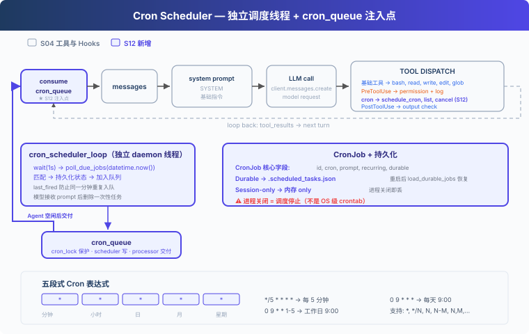

# s12: Cron Scheduler — 按时间启动任务

> ℹ️ 下面的代码片段摘自同目录 `AgentLoop.java`（有删减，完整可运行版见该文件）。
> Java 版用两个 daemon `Thread` + 两把 `ReentrantLock`（`CRON_LOCK` 保护任务表和队列，`AGENT_LOCK` 保护会话历史）实现，
> 停止信号是 `AtomicBoolean RUNTIME_STOP`，对应 Python 原版的 `threading.Event`。

s01 → ... → s10 → s11 → `s12` → [s13](../s13_agent_teams/) → ... → s17

---

## 问题

S11 解决的是命令开始后的执行方式：耗时的 Bash 命令可以在后台运行。但它不会记录某项工作应该在什么时间开始，也没有组件持续检查当前时间。

对于“每天早上 9 点跑测试”或“每 30 分钟检查 CI 状态”这样的请求，如果只依靠当前的 Agent Loop，用户仍要在每次到点后重新发送 prompt。Harness 需要保存执行时间，到点后把对应的 prompt 加入待执行队列，再在 Agent 空闲时交给 Agent Loop。

---

## 解决方案



假设 Agent 注册了下面这项任务：

```text
cron:   0 9 * * *
prompt: run tests
```

调度线程在本地时间 09:00 匹配到这项任务，把它放进 `CRON_QUEUE`。队列处理线程等到 Agent 空闲后启动一轮 Agent Loop，并把 `[Scheduled] run tests` 作为用户消息交给模型，模型随后可以调用 Bash 执行测试。

S12 的代码保留 S04 的五个基础工具和 Hooks，再增加 `schedule_cron`、`list_crons`、`cancel_cron`。它不包含 S11 的后台命令，因为这里传递的是一条待执行的 prompt，而不是某个后台命令的执行结果。

---

## 工作原理

### CronJob 保存什么

```java
/**
 * CronJob 是可变对象 (pendingDelivery/lastFired 会被后台线程改)
 * 用普通 class 而不是 record, 因为 record 字段全 final 改不了。
 */
static final class CronJob {
    String id;              // cron_ + 8 位 hex
    String cron;
    String prompt;
    boolean recurring;
    boolean durable;
    boolean pendingDelivery;
    String lastFired;       // "yyyy-MM-dd HH:mm" 或 null
    // ... 构造器, toMap() / fromMap() 负责与 JSON 互转
}

private static final Map<String, CronJob> SCHEDULED_JOBS = new LinkedHashMap<>();  // 全部任务
private static final List<CronJob> CRON_QUEUE = new ArrayList<>();                  // 已到期待交付
private static final ReentrantLock CRON_LOCK = new ReentrantLock();                 // 保护上面两个
```

`cron` 决定何时触发，`prompt` 是触发后交给 Agent 的任务。`pendingDelivery` 表示任务已经到期但尚未被模型接收，`lastFired` 防止同一分钟重复入队。写进 `.scheduled_tasks.json` 时字段名仍用 `pending_delivery` / `last_fired`，和 Python 原版的文件格式一致。

模型调用 `schedule_cron` 时，`recurring` 和 `durable` 都可以省略，省略时默认为 `true`。

### 五段式 Cron 表达式

```text
分钟  小时  日  月  星期
  *    *   *   *   *      每分钟
  0    9   *   *   *      每天 09:00
 */5   *   *   *   *      每 5 分钟
  0    9   *   *  1-5     工作日 09:00
```

本章支持 `*`、`*/N`、`N`、`N-M` 和 `N,M,...`。`scheduleJob()` 会在保存任务前调用 `validateCron()`，拒绝字段数量或取值范围不正确的表达式：

```java
private static String validateCron(String cronExpr) {
    String[] fields = cronExpr.strip().split("\\s+");
    if (fields.length != 5) return "Expected 5 fields, got " + fields.length;
    String[] names = {"minute", "hour", "day-of-month", "month", "day-of-week"};
    int[][] ranges = {{0, 59}, {0, 23}, {1, 31}, {1, 12}, {0, 6}};
    for (int i = 0; i < 5; i++) {
        String err = validateField(fields[i], ranges[i][0], ranges[i][1]);
        if (err != null) return names[i] + ": " + err;
    }
    return null;   // null 表示合法
}
```

匹配时要注意星期的编号：cron 里 `0` 是周日，而 Java 的 `DayOfWeek` 是周一 `1` 到周日 `7`，所以 `cronMatches` 用 `% 7` 换算。日和星期同时被限定时按 POSIX cron 的规则取“或”：

```java
int cronWeekday = moment.getDayOfWeek().getValue() % 7;   // 0=Sun, 1=Mon, ..., 6=Sat
// ... 分钟 / 小时 / 月不匹配就直接 return false

boolean dayMatches = fieldMatches(day, moment.getDayOfMonth());
boolean weekdayMatches = fieldMatches(weekday, cronWeekday);
if ("*".equals(day) && "*".equals(weekday)) return true;
if ("*".equals(day)) return weekdayMatches;
if ("*".equals(weekday)) return dayMatches;
return dayMatches || weekdayMatches;
```

### 到期后先入队

调度线程（`cronSchedulerLoop`）每秒用 `LocalDateTime.now()` 读取一次本地时间。表达式匹配且任务在当前分钟尚未触发时，`enqueueDueJob()` 先保存 `pendingDelivery` 和 `lastFired`，再把任务放进内存队列：

```java
private static void pollDueJobs(LocalDateTime moment) {
    String minuteMarker = moment.format(DateTimeFormatter.ofPattern("yyyy-MM-dd HH:mm"));
    CRON_LOCK.lock();
    try {
        for (CronJob job : new ArrayList<>(SCHEDULED_JOBS.values())) {
            try {
                // 已 pending 或本分钟已 fire 过 → 跳过 (防重)
                if (job.pendingDelivery || minuteMarker.equals(job.lastFired)) continue;
                if (cronMatches(job.cron, moment)) enqueueDueJob(job, minuteMarker);
            } catch (Exception e) {
                System.out.println("  [cron] could not enqueue " + job.id + ": " + e.getMessage());
            }
        }
    } finally { CRON_LOCK.unlock(); }
}

/** 需要在 CRON_LOCK 保护下调用 */
private static void enqueueDueJob(CronJob job, String minuteMarker) {
    boolean oldPending = job.pendingDelivery;
    String oldLastFired = job.lastFired;
    job.pendingDelivery = true;
    if (minuteMarker != null) job.lastFired = minuteMarker;
    try {
        if (job.durable) saveDurableJobs();
    } catch (Exception e) {
        job.pendingDelivery = oldPending;
        job.lastFired = oldLastFired;
        throw e;
    }
    CRON_QUEUE.add(job);
}
```

持久化失败时，`enqueueDueJob()` 会恢复原来的状态，不会把只存在于内存中的任务暴露给队列处理线程。单个任务入队失败只打印日志，不影响同一轮里的其他任务。

### Agent 空闲后再交付

`queueProcessorLoop()` 不负责判断时间。它每 200ms 检查一次队列，并用 `AGENT_LOCK` 避免定时任务与用户正在进行的回合同时修改会话：

```java
private static void queueProcessorLoop() {
    while (!RUNTIME_STOP.get()) {
        try { Thread.sleep(200); } catch (InterruptedException e) { break; }
        if (RUNTIME_STOP.get()) break;
        if (!hasCronQueue()) continue;
        if (AGENT_LOCK.tryLock()) {
            try {
                if (hasCronQueue()) runAgentTurnLocked(null);   // null = 纯 cron 触发, 没有用户输入
            } catch (Exception e) {
                System.out.println("  [error] cron processor: " + e.getMessage());
            } finally {
                AGENT_LOCK.unlock();
            }
        }
        // 抢不到 lock 就等下一次
    }
}
```

两边拿锁的方式不同：队列处理线程用 `tryLock()`，抢不到就等下一次；主线程处理用户输入时用阻塞的 `lock()`，保证用户的回合不会被跳过：

```java
AGENT_LOCK.lock();
try {
    runAgentTurnLocked(q);
} finally {
    AGENT_LOCK.unlock();
}
```

Agent Loop 一开始就从队列取出到期任务，并把它们作为新的用户消息追加。所以用户回合开始时如果正好有到期任务，也会一起交付：

```java
List<CronJob> fired = consumeCronQueue();
int scheduledStart = messages.size();
for (CronJob job : fired) {
    messages.add(MessageParam.builder()
            .role(MessageParam.Role.USER)
            .content("[Scheduled] " + job.prompt)
            .build());
}
List<CronJob> waitingForAck = new ArrayList<>(fired);
```

模型调用失败时，这些消息会从当前会话中移除，任务重新放回队列。模型成功接收后，一次性任务会被删除，周期任务则清除 `pendingDelivery`，等待下一次匹配：

```java
Message response;
try {
    response = CLIENT.messages().create(params);
} catch (Exception e) {
    // LLM 失败: 回滚 messages + restore cron jobs
    if (!waitingForAck.isEmpty()) {
        while (messages.size() > scheduledStart) messages.remove(messages.size() - 1);
        restoreCronJobs(waitingForAck);
    }
    return;
}
messages.add(assistantMessageParam(response));

// LLM 成功 → ack (recurring 清 pending, one-shot 删除)
if (!waitingForAck.isEmpty()) {
    try { acknowledgeCronJobs(waitingForAck); }
    catch (Exception e) { System.out.println("  [cron] ack failed: " + e.getMessage()); }
    waitingForAck.clear();
}
```

`acknowledgeCronJobs` 本身也带回滚：如果保存 `.scheduled_tasks.json` 失败，它会恢复被删除的一次性任务和原来的 `pendingDelivery`，并把这些任务重新放回队列。

### 持久化边界

| 模式 | 保存位置 | 进程重启后 |
|---|---|---|
| `durable=true`（默认） | `.scheduled_tasks.json` | 重新加载 |
| `durable=false` | 内存 | 消失 |

`.scheduled_tasks.json` 先写临时文件，再用原子重命名替换：

```java
private static void saveDurableJobs() {
    CRON_LOCK.lock();
    try {
        List<Map<String, Object>> payload = new ArrayList<>();
        for (CronJob j : SCHEDULED_JOBS.values()) {
            if (j.durable) payload.add(j.toMap());
        }
        String json = JSON_MAPPER.writerWithDefaultPrettyPrinter().writeValueAsString(payload);
        Path tmp = DURABLE_PATH.resolveSibling(
                DURABLE_PATH.getFileName() + "." + ProcessHandle.current().pid()
                + "." + Thread.currentThread().getId() + ".tmp");
        try {
            Files.writeString(tmp, json);
            // ATOMIC_MOVE = POSIX rename(2), Windows 尽力而为
            Files.move(tmp, DURABLE_PATH, StandardCopyOption.ATOMIC_MOVE,
                    StandardCopyOption.REPLACE_EXISTING);
        } finally {
            try { Files.deleteIfExists(tmp); } catch (Exception ignore) {}
        }
    } catch (Exception e) {
        throw new RuntimeException("Failed to save durable jobs: " + e.getMessage(), e);
    } finally { CRON_LOCK.unlock(); }
}
```

启动时 `loadDurableJobs()` 读回这个文件，`pendingDelivery` 为 `true` 的任务直接放回队列。文件整体解析失败时，启动日志会打印 `[cron] could not load ...`；单条记录不合法（表达式错误、ID 不以 `cron_` 开头、prompt 为空）时打印 `[cron] skipped invalid saved job: ...` 并跳过这一条，不会静默忽略。

这里采用至少一次交付：进程若在模型接收 prompt 后、确认状态写回前退出，同一任务可能在重启后再次交付。

### 运行边界

- 调度器使用 Agent 进程的本地时间。
- Agent 进程关闭后，调度线程也会停止；`durable` 只保留任务定义。
- 重启时只恢复任务，不补跑停机期间错过的时间点。
- 定时回合运行在队列处理线程中。Java 版的权限检查只有 deny-list，没有 Python 原版那种 `Allow? [y/N]` 交互确认，所以定时回合不会和主终端抢着读输入；Python 原版则会在非主线程直接拒绝需要确认的调用。
- 调度线程和队列处理线程只在 `main()` 里通过 `startRuntimeThreads()` 启动，`AgentLoop` 类被加载时不会启动后台线程。退出时 `stopRuntimeThreads()` 置位 `RUNTIME_STOP` 并 `join` 两个线程，JVM shutdown hook 再兜底调用一次。

需要在 Agent 关闭时仍按时执行任务，应使用系统的 crontab、systemd timer 或其他外部调度服务。

---

## 试一下

```sh
cd learn-claude-code-java
mvn -q compile exec:java -Dexec.mainClass=com.learn.cc.s12_cron_scheduler.AgentLoop
```

可以依次输入：

1. `Schedule "run date" every 2 minutes and keep it after restart.`
2. `List all cron jobs.`
3. `Cancel the cron job you just created.`

运行时可以查看 `.scheduled_tasks.json`，并观察到期后出现的 `[Scheduled] run date` 消息。测试一分钟级任务时，Agent 进程需要保持运行。

---

## 接下来

调度器可以在指定时间启动一轮 Agent Loop，但这一轮仍由一个 Agent 处理。面对需要同时调查多个模块、并行修改并汇总结果的任务，Harness 还需要把工作分给多个 Agent，并收集各自的执行结果。

s13 Agent Teams → Lead 分配任务，队友独立执行，再通过收件箱返回结果。

<!-- translation-sync: zh@v9, en@v9, ja@v9 -->
