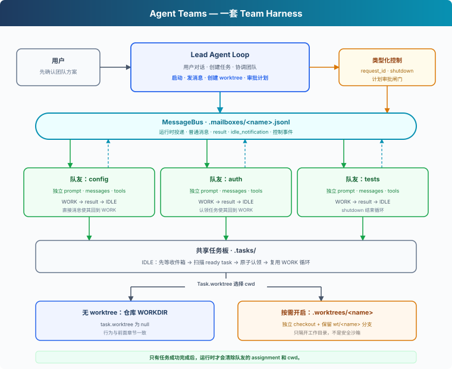
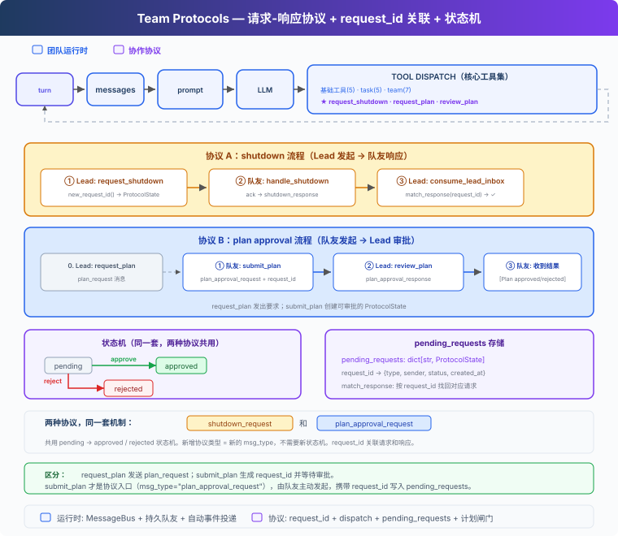

# s13: Agent Teams — 团队运行时与协作协议

> ℹ️ 下面的代码片段摘自同目录 `AgentLoop.java`（有删减，完整可运行版见该文件）。
> 本章 Java 版是**教学骨架**：Python 原版约 1900 行，Java 版保留了队友线程、文件收件箱、任务认领、worktree 和两种协议，
> 但去掉了 fcntl 跨进程文件锁、计划的 work version 追踪和一部分失败回滚。正文中凡是 Java 行为与原版不同的地方都会单独标出。

s01 → ... → [s10](../s10_task_system/) → `s13` → [s14](../s14_mcp_plugin/) → s15 → s16 → s17

> *“一个 Agent 装不下整项工作时，就让队友分头完成。”* — 持久队友、共享任务认领、可选 worktree 与协作协议。
>
> **Harness 层**：Team（团队）— 多个 Agent 如何分工、共享状态，同时接受 Lead 控制。

---

## 问题

假设我们让 Agent 重构整个后端，工作涉及配置加载、认证和测试。一个 Agent 可以依次处理，但总耗时更长，早期细节也会逐渐离开上下文。

这类工作适合并行，可用户通常只描述目标，不会替运行时设计团队：

```text
重构这个示例后端。清理配置加载、认证和测试，
保持现有接口，并确保测试通过。
```

Harness 需要回答一组相互关联的问题：

1. 谁判断并行是否有用，新增 Agent 又由谁确认？
2. 每个队友如何跨任务保留身份和上下文？
3. 结果如何自动返回 Lead，而不是让模型轮询收件箱？
4. 空闲队友能否直接接手 ready task，不再等待 Lead 逐项派发？
5. 并行修改可能冲突时，任务应该使用哪个工作目录？
6. 关机和计划审批如何成为可追踪、可执行的协议？

---

## 解决方案



s13 复用 s10 的基础工具和 Task System，并增加一套由 Lead 管理的团队运行时（Java 版没有带上 s04 的 Hooks 和 Permission，Lead 和队友的 bash 都没有 deny-list）：

- **Lead** 负责用户对话，提出分工方案并等待确认。
- **队友** 运行独立 Agent Loop，在 WORK 和 IDLE 之间切换。
- **MessageBus** 通过文件收件箱传递普通消息、结果和控制事件。
- **运行时投递** 消费 Lead 的收件箱，把团队事件注入下一轮对话。
- **共享任务板** 让空闲队友发现 ready task，并在锁内完成认领。
- **可选 worktree** 在需要时把任务绑定到另一个工作目录；未绑定任务仍使用仓库目录。
- **类型化协议和计划闸门** 显式记录关机与审批状态，并在计划获批前阻止修改型工具。

任务图继续采用 s10 的两阶段契约。Lead 先为所有节点调用 `create_task`，再使用返回的运行时 ID 调用 `update_task(addBlockedBy=...)`，最后才分配 ready task。只有 Lead 能使用 `update_task`；队友只能列举、认领和完成任务，团队运行期间不能改写任务图结构。

s11 的后台任务和 s12 的定时任务没有被带入本章。它们不参与队友通信、任务认领或计划审批。

这些机制都属于 Team 这一层。任务发现不需要另一套 Agent Loop，worktree 也不会产生另一种 Agent。

---

## 工作原理

### 1. Lead 先提出团队，再等待用户确认

启动队友会改变成本、并发度和可以修改工作区的角色集合。Lead 的系统提示词会把这条边界明确写出来：

```java
private static final String SYSTEM =
        "You are the Lead agent at " + WORKDIR + ". Act, don't explain.\n\n"
                // ...
                + "When parallel work would help, first propose a small team with clear "
                + "responsibilities and wait for the user's confirmation. Do not call "
                + "spawn_teammate before the user confirms. After confirmation, spawn "
                + "teammates for independent tasks. "
                + "Pass task_id to spawn_teammate when assigning ready work. "
                // ... worktree 说明
                + "After spawning, end your turn instead of polling; the runtime will "
                + "wake you when teammates send events. React to those events, and shut "
                + "teammates down when done.";
```

这只是提示词层面的约束，`spawn_teammate` 工具本身不检查用户是否确认过。

收到第一条需求后，Lead 只提出分工：

```text
我建议并行处理三个方向：
- config：清理配置加载
- auth：重构认证
- tests：补充回归测试

你确认后我再启动队友。
```

用户回复“开始吧”后，Lead 才能调用 `spawn_teammate`。Lead 会先创建任务，再把初始 `task_id` 传给队友。用户给出目标，Lead 设计团队，用户确认执行边界。

### 2. 每个队友拥有独立循环

s06 的 subagent 是一次性调用，队友则是持久执行单元：

| | s06 Subagent | s13 队友 |
|---|---|---|
| 生命周期 | 一次调用后结束 | `WORK → IDLE → WORK`，直到关机 |
| 上下文 | 只服务一个任务 | 跨任务保留 |
| 通信 | 返回一次结果 | 接收消息并发出事件 |
| 协作 | 单向委派 | 与 Lead 双向协作 |

`TeammateRuntime` 为每个队友保存独立的系统提示词、messages 和工具集（`TEAMMATE_TOOLS`），再在一个 daemon 线程中运行 WORK / IDLE 循环。队友工作时，Lead 可以继续协调其他任务：

```java
@Override
public void run() {
    try {
        String state = "continue";
        while (!"stop".equals(state)) {
            if ("idle".equals(state) && !waitForWork()) break;   // IDLE: 等消息或自己认领任务
            state = work();                                      // WORK: 跑一次模型调用
        }
    } catch (Exception e) {
        BUS.send(name, "lead", e.getClass().getSimpleName() + ": " + e.getMessage(), "error", null);
    } finally {
        // 退出时把没做完的任务退回 pending, 并清掉 assignment / 闸门 / 线程句柄
        // ...
    }
}
```

`work()` 返回 `continue`（有工具调用，继续下一轮）、`idle`（本轮没有工具调用）或 `stop`（收到关机请求或模型调用出错）。`lead` 和 `agent` 保留给运行时身份（`RESERVED_NAMES`），不能用作队友名，但 `MessageBus` 仍允许把 `lead` 作为协调者收件箱。

`spawnTeammate` 在线程启动前认领初始任务。认领失败时不会启动队友：

```java
if (taskId != null) {
    String claimed = claimTaskFor(taskId, name);
    if (!claimed.startsWith("Claimed")) {
        ACTIVE_TEAMMATES.remove(name);
        PLAN_GATES.remove(name);
        return "Cannot spawn teammate '" + name + "': " + claimed;
    }
}
TeammateRuntime rt = new TeammateRuntime(name, role, prompt, taskId, requirePlan);
Thread t = new Thread(rt, "teammate-" + name);
t.setDaemon(true);
t.start();
```

队友没有任务时，文件和 Shell 工具会返回 `Error: Claim a Task before using workspace tools.`，而不是回退到仓库目录。

### 3. MessageBus 把通信放在模型上下文之外

Lead 和队友不能共享同一个 messages 数组，否则一个队友的工具结果会进入另一个队友的推理上下文。`MessageBus` 为每个 Agent 提供 `.mailboxes/<name>.jsonl` 收件箱：

```java
static final class MessageBus {
    private final ReentrantLock lock = new ReentrantLock();
    private final Condition changed = lock.newCondition();

    void send(String from, String to, String content, String type, Map<String, Object> metadata) {
        lock.lock();
        try {
            Files.createDirectories(MAILBOX_DIR);
            Map<String, Object> msg = new LinkedHashMap<>();
            msg.put("from", from); msg.put("to", to); msg.put("content", content);
            msg.put("type", type);
            msg.put("ts", System.currentTimeMillis() / 1000.0);
            msg.put("metadata", metadata == null ? Map.of() : metadata);
            // 必须写成单行: JSON_MAPPER 全局开了 INDENT_OUTPUT, 直接 writeValueAsString 会输出多行 JSON,
            // 破坏 jsonl "一行一条消息" 的格式, readInbox 逐行解析会全部失败, 消息被静默丢弃
            String line = JSON_MAPPER.writer().without(SerializationFeature.INDENT_OUTPUT)
                    .writeValueAsString(msg) + "\n";
            Files.writeString(mailboxPath(to), line,
                    StandardOpenOption.CREATE, StandardOpenOption.APPEND);
            changed.signalAll();
        } catch (Exception e) {
            System.err.println("[bus] send failed: " + e.getMessage());
        } finally { lock.unlock(); }
    }

    /** 阻塞等待直到有消息或超时 */
    List<Map<String, Object>> waitForMessages(String agent, long timeoutMs) {
        long deadline = System.currentTimeMillis() + timeoutMs;
        lock.lock();
        try {
            while (!peek(agent)) {
                long remaining = deadline - System.currentTimeMillis();
                if (remaining <= 0) return List.of();
                try { changed.await(remaining, TimeUnit.MILLISECONDS); }
                catch (InterruptedException e) { Thread.currentThread().interrupt(); return List.of(); }
            }
            return readInbox(agent);
        } finally { lock.unlock(); }
    }
}
```

`ReentrantLock` 保护收件箱文件，避免队友并发读写；`peek` / `readInbox` 在 `waitForMessages` 里再次加锁也没问题，因为锁可重入。`Condition` 既能在消息到达时唤醒队友，也能支持 IDLE 状态下的短时等待。和 Python 原版不同，Java 版的 `waitForMessages` 必须传超时，没有“无限等待”的形式。

### 4. 收件箱事件由运行时投递

`readInbox()` 会读取并删除收件箱文件，因此 Lead 只保留一个消费者 `consumeLeadInbox()`：

```java
private static List<Map<String, Object>> consumeLeadInbox() {
    List<Map<String, Object>> msgs = BUS.readInbox("lead");
    for (Map<String, Object> msg : msgs) {
        String type = String.valueOf(msg.getOrDefault("type", "message"));
        Map<String, Object> metadata = (Map<String, Object>) msg.getOrDefault("metadata", Map.of());
        if (type.endsWith("_response")) {
            String requestId = String.valueOf(metadata.getOrDefault("request_id", ""));
            ProtocolState state = PENDING_REQUESTS.get(requestId);
            if (state != null && "pending".equals(state.status)) {
                boolean approve = Boolean.TRUE.equals(metadata.get("approve"));
                state.status = approve ? "approved" : "rejected";
            }
        }
    }
    return msgs;
}
```

CLI 主循环同时等待终端输入和 Lead 收件箱。Python 原版用 `select.select` 带超时地等 stdin；Java 的 `Scanner.nextLine()` 只能阻塞读，所以拆成一个专门读 stdin 的 daemon 线程，把每一行放进 `CLI_INPUT` 队列，主线程则交替检查收件箱和队列：

```java
/** 对应 Python wait_for_cli_event: 收件箱优先, 其次每 250ms 看一次有没有用户输入 */
private static CliEvent waitForCliEvent() {
    boolean promptVisible = false;
    while (true) {
        if (BUS.peek("lead")) {
            if (promptVisible) System.out.println();
            return new CliEvent("wake", null);
        }
        if (!promptVisible) {
            System.out.print("\033[36ms13v >> \033[0m");
            promptVisible = true;
        }
        Optional<String> line;
        try { line = CLI_INPUT.poll(250, TimeUnit.MILLISECONDS); }
        catch (InterruptedException e) { /* ... */ return new CliEvent("quit", null); }
        if (line == null) continue;                              // 超时: 回去 peek 收件箱
        if (line.isEmpty()) return new CliEvent("quit", null);   // stdin EOF
        return new CliEvent("user", line.get());
    }
}
```

`main` 拿到 `wake` 时直接开一轮 Lead 调用，不需要用户输入任何内容；拿到 `user` 时，也会先把同时到达的团队事件消费掉，再追加用户消息。新消息到达时的处理顺序是：

```text
MessageBus → consumeLeadInbox
           → 更新协议状态
           → 把 [Team events] 注入 history
           → 启动新一轮 Lead 调用
```

Lead 启动队友后会结束当前轮次，不用反复调用 `list_teammates` 或 `get_task` 等待结果。队友事件到达时，运行时会自动唤醒下一轮。

`check_inbox` 不是模型工具。消息到达和消费属于运行时，模型只处理已经投递到上下文里的事件。

### 5. 结果与 IDLE 是两个事件

队友完成一项任务后，运行时按顺序发送两个事件：

```text
result:            "认证已重构，相关测试通过。"
idle_notification: "Waiting for more work."
```

`result` 回答“这项任务产出了什么”，`idle_notification` 回答“这个队友能否继续接任务”。一个含糊的“完成了”无法同时表达这两种状态。

两个事件都在 `work()` 的结尾发出：模型这一轮没有调用工具时，把最终文本作为 `result` 发给 Lead，再发 `idle_notification`。如果队友的计划还在等审批（闸门为 `pending`），两条都不发，只把状态标成 `waiting_approval`：

```java
String summary = /* 本轮回复里的全部 text */;
String gate = PLAN_GATES.getOrDefault(name, "not_required");
if (!"pending".equals(gate) && !summary.isEmpty()) {
    BUS.send(name, "lead", summary, "result", null);
}
if ("pending".equals(gate)) {
    ACTIVE_TEAMMATES.put(name, "waiting_approval");
} else {
    ACTIVE_TEAMMATES.put(name, "idle");
    BUS.send(name, "lead", "Waiting for more work.", "idle_notification", null);
}
return "idle";
```

空闲队友不会退出。直接消息或 ready task 会让它回到 WORK，`shutdown_request` 则会启动平滑关机握手。

### 6. IDLE 先看收件箱，再找 ready task

队友进入 IDLE 后优先处理消息，然后检查共享任务板：

```java
boolean waitForWork() {
    while (true) {
        List<Map<String, Object>> inbox = BUS.waitForMessages(name, 2000);
        if (!inbox.isEmpty()) {
            int before = messages.size();
            if (handleInbox(inbox)) return false;          // 收到关机请求 → 退出
            if (messages.size() > before) return true;     // 有新的待处理消息 → 回到 WORK
            continue;
        }
        // 没消息 → 试着自己找活干
        Task t = claimNextTaskFor(name);
        if (t != null) {
            messages.add(MessageParam.builder().role(MessageParam.Role.USER)
                    .content("[Auto-claimed task " + t.id() + "] "
                            + t.subject() + "\n" + t.description()
                            + "\nWork directory: " + /* assignmentCwd(name) */ wd).build());
            return true;
        }
        // 也没活 → 继续等
    }
}
```

关机、计划审批和 Lead 的直接指令应该先于临时发现的工作。如果没有消息，也没有 ready task，队友会保持 IDLE。前置任务完成后，当前受阻的任务可能变为 ready。

### 7. 发现和认领分成两步，认领必须原子执行

扫描只负责找候选任务。Java 版没有单独的 `scan_unclaimed_tasks`，`claimNextTaskFor` 边扫描边尝试认领：

```java
private static Task claimNextTaskFor(String owner) {
    for (Task t : listTasks()) {
        if (!"pending".equals(t.status()) || t.owner() != null) continue;
        if (!canStart(t)) continue;
        try { taskWorktreeCwd(t); } catch (Exception e) { continue; }   // 跳过 worktree 绑定已损坏的
        String result = claimTaskFor(t.id(), owner);
        if (result.startsWith("Claimed")) {
            try { return loadTask(t.id()); } catch (Exception ignore) {}
        }
    }
    return null;
}
```

扫描时看到的状态只是某一时刻的快照，其他队友也可能看到同一任务。因此所有权变更必须放进 `claimTaskFor()`，在 `TASK_LOCK` 里重新读取任务、重新检查：

```java
private static String claimTaskFor(String taskId, String owner) {
    TASK_LOCK.lock();
    try {
        Task t = loadTask(taskId);
        if (!"pending".equals(t.status())) return "Task " + taskId + " is " + t.status() + ", cannot claim";
        if (t.owner() != null) return "Task " + taskId + " already owned by " + t.owner();
        if (TEAMMATE_ASSIGNMENTS.get(owner) != null)
            return owner + " already has assignment " + TEAMMATE_ASSIGNMENTS.get(owner);
        if (!canStart(t)) return "Blocked by deps";
        try {
            taskWorktreeCwd(t);   // fail closed: 拒绝 claim 一个 worktree 绑定已损坏的任务
        } catch (Exception e) {
            return "Cannot claim " + taskId + ": " + e.getMessage();
        }
        Task updated = new Task(t.id(), t.subject(), t.description(), "in_progress", owner,
                t.blockedBy(), t.worktree());
        saveTask(updated);
        TEAMMATE_ASSIGNMENTS.put(owner, taskId);
        return "Claimed " + taskId + " (" + updated.subject() + ")";
    } catch (Exception e) { return "Error: " + e.getMessage(); }
    finally { TASK_LOCK.unlock(); }
}
```

多个队友可以同时发现同一候选，但只有一个 claim 能把它推进到 `in_progress`。队友完成当前任务后才能再认领下一项；worktree 绑定损坏时，认领会直接失败，不会回退到仓库目录。

> 和 Python 原版的差别：`TASK_LOCK` 只是 JVM 内的 `ReentrantLock`，没有 fcntl 文件锁，所以只能保证同一进程内的队友不会抢到同一任务；两个 Harness 进程共用同一个 `.tasks/` 目录时不受保护。`saveTask` 也是直接 `Files.writeString` 覆盖，没有“先写临时文件再原子替换”。

### 8. 认领后的工作复用同一个 WORK 循环

认领成功后，运行时把任务 ID、标题和描述放进队友的 messages：

```text
任务板出现 ready task
  → IDLE 队友发现候选
  → claim_task 写入 owner 和 in_progress
  → 任务进入队友 messages
  → WORK
  → complete_task
  → result + idle_notification
  → IDLE
```

队友继续使用直接派发任务时的模型调用、文件工具、Shell、计划闸门、结果上报和关机协议。任务发现只是现有 WORK 循环的另一个入口。

### 9. 由任务选择工具的工作目录

`Task.worktree` 是可选字段：

```java
public record Task(String id, String subject, String description,
                   String status, String owner, List<String> blockedBy,
                   String worktree) {}   // worktree 为 null 表示使用仓库目录
```

并行修改需要分开目录时，Lead 可以调用 `create_worktree` 工具创建并绑定 worktree，对应的 Java 方法是：

```java
createWorktree("auth-refactor", "task_1a2b3c4d");
// → git worktree add -b wt/auth-refactor .worktrees/auth-refactor HEAD
// → 成功后才把 worktree 名写进任务
```

`create_worktree` 只提供给 Lead。它要求任务处于 pending、无人认领且尚未绑定，随后检查名称、路径、分支和 Git 注册信息，创建 checkout，最后才写入任务绑定。如果 Git 报告失败却已经留下分支或已注册的 checkout，运行时会报告 partial operation，让任务保持未绑定，并保留这些内容供人工恢复。队友只使用任务工具和文件工具。

认领任务时，运行时把任务 ID 写入 `TEAMMATE_ASSIGNMENTS`（`owner → taskId`）。Java 版不缓存目录，该队友的 `bash`、`read_file`、`write_file`、`edit_file` 和 `glob` 每次调用都通过 `assignmentCwd` 重新解析：没有绑定 worktree 的任务解析到 `WORKDIR`；绑定损坏时直接报错；没有认领任务的队友不能使用这些工作区工具：

```java
private static Path assignmentCwd(String owner) throws IOException {
    String taskId = TEAMMATE_ASSIGNMENTS.get(owner);
    if (taskId == null) return WORKDIR;
    Task t = loadTask(taskId);
    boolean live = ("in_progress".equals(t.status()) || "completed".equals(t.status()))
            && owner.equals(t.owner());
    if (!live) throw new IOException("assignment for " + owner + " is no longer active");
    return taskWorktreeCwd(t);   // task.worktree 为空 → WORKDIR; 否则校验 Git 注册信息和分支
}

/** TeammateRuntime 里: 文件工具必须先 claim 一个任务 */
private String withCwd(FsOp op) {
    if (!TEAMMATE_ASSIGNMENTS.containsKey(name)) {
        return "Error: Claim a Task before using workspace tools.";
    }
    Path cwd;
    try { cwd = assignmentCwd(name); }
    catch (Exception e) { return "Error: Invalid task assignment: " + e.getMessage(); }
    return op.run(cwd);
}
```

`complete_task` 对应 `completeTaskFor(taskId, owner)`，它会检查调用者是否拥有这个进行中的任务，并且计划闸门不能处于 `required` / `pending` / `rejected`。完成失败时 assignment 保持不变，方便修正后重试。

> 和 Python 原版的差别：
> - Python 成功完成后不会马上释放 assignment，同一模型轮次里的后续工具调用仍使用任务目录，回到 IDLE 时才释放。Java 版在 `completeTaskFor` 成功时就 `TEAMMATE_ASSIGNMENTS.remove(owner)`，所以同一轮里紧接着的文件或 Shell 调用会收到 `Claim a Task before using workspace tools.`。
> - Python 重启后能根据持久化任务中的 owner 和 worktree 恢复 assignment。Java 版的 `TEAMMATE_ASSIGNMENTS` 只在内存里，队友线程也是 daemon 线程，进程退出时不会走到把任务退回 `pending` 的 `finally`。重启后，原来 `in_progress` 的任务仍挂在已经不存在的队友名下，需要手动改回 `pending`。

> Worktree 只分开 Git 工作目录和分支，不是安全沙箱。Shell 命令仍能访问父进程有权访问的路径和资源。

### 10. Worktree 移除由宿主负责

模型可以创建任务绑定的 worktree，但不能移除它。`removeWorktree(name, discardChanges)` 在 Java 里定义了，却没有放进任何工具列表，只留给宿主代码调用，让用户或宿主先检查任务所有权和 Git 状态：

```java
for (Task t : bound) {
    if (!"completed".equals(t.status())) {
        return "Error: Worktree '" + name + "' is bound to active task " + t.id()
                + "; complete it before removal";
    }
}
GitResult status = runGit(List.of("status", "--porcelain", "--ignored"), path);
// ...
if (!"(no output)".equals(status.output()) && !discardChanges) {
    return "Error: Worktree '" + name + "' has uncommitted changes; "
            + "preserve or discard them manually";
}
List<String> args = new ArrayList<>(List.of("worktree", "remove"));
if (discardChanges) args.add("--force");
args.add(path.toString());
// git worktree remove ... 成功后清空任务的 worktree 字段; wt/<name> 分支始终保留
```

它会拒绝绑定到 pending 或 in-progress 任务的 worktree；未明确选择破坏性移除时，已跟踪、未跟踪和已忽略文件都会阻止清理（Python 原版还会检查当前轮次仍在使用的 assignment lease，Java 版没有这一项）。

`removeWorktree(name, true)` 只供已经另行取得用户明确确认的宿主调用。两种移除路径都只执行 `git worktree remove`，不删除仓库里的 `wt/<name>` 分支，包括没有 upstream 的干净本地提交。移除成功后，任务绑定会被清空。

```text
干净 worktree   → 宿主可移除目录，保留 wt/<name> 分支
有改动 worktree → 由用户决定保留还是丢弃
待办/进行中任务 → 拒绝移除
```

任务完成与 worktree 清理也互相独立。`complete_task` 记录任务结果；队友回到 IDLE 后，用户或宿主才检查、合并、保留或移除 worktree。

### 11. 控制消息使用类型和 request_id

普通协作可以使用自由文本，关机和审批则不能依靠猜测消息意图。它们使用结构化消息：



```java
static final class ProtocolState {
    final String requestId;
    final String type;      // "shutdown" | "plan_approval"
    final String sender;
    final String target;
    volatile String status; // "pending" | "approved" | "rejected"
    final String payload;
    // ... 构造时 status = "pending"
}

private static final Map<String, ProtocolState> PENDING_REQUESTS = new ConcurrentHashMap<>();
```

Python 原版的 `ProtocolState` 还有 `work_version` 和 `task_id`，Java 版没有，原因见下一节。

关机路径如下：

```text
Lead 创建 pending 状态的关机请求
  → shutdown_request(request_id) 进入队友收件箱
  → 队友完成当前步骤
  → shutdown_response(request_id) 返回 Lead
  → request_id 找到原始请求
  → pending 变为 approved，队友循环退出
```

ID 把回复关联到请求，状态则阻止同一回复重复生效。队友收到 `shutdown_request` 时会核对请求的类型、发起者和目标，不匹配就忽略：

```java
case "shutdown_request" -> {
    ProtocolState state = PENDING_REQUESTS.get(requestId);
    if (state != null && "shutdown".equals(state.type) && "lead".equals(state.sender)
            && name.equals(state.target)) {
        ACTIVE_TEAMMATES.put(name, "stopping");
        BUS.send(name, "lead", "Shutdown acknowledged.", "shutdown_response",
                Map.of("request_id", requestId, "approve", true));
        return true;   // 让 run() 退出循环
    }
    workMsgs.add("[Ignored shutdown_request: mismatch]");
}
```

Lead 一侧的 `consumeLeadInbox` 只按 `request_id` 和 `pending` 状态匹配，不核对回复类型和回复者。

### 12. 计划审批会约束执行

计划协议的方向相反：

```text
Lead → plan_request
队友 → plan_approval_request(request_id, plan)
Lead → plan_approval_response(request_id, approve, feedback)
```

如果 Lead 在启动队友前就知道必须先看计划，可以调用 `spawn_teammate(..., task_id=task.id, require_plan=true)`；运行时会先认领任务并打开闸门，再启动线程。对于已经运行的队友，也可以再用 `request_plan` 要求其提交计划。

工具分发层负责执行闸门：

```java
private String runTeammateTool(ToolUseBlock block, Map<String, Object> input) {
    String toolName = block.name();
    // Plan Gate: bash/write/edit 需要 approved 才能用
    if (Set.of("bash", "write_file", "edit_file").contains(toolName)) {
        String gate = PLAN_GATES.getOrDefault(name, "not_required");
        if (!"approved".equals(gate) && !"not_required".equals(gate)) {
            return "Blocked: plan status is " + gate
                    + ". Submit or revise the plan and wait for approval.";
        }
    }
    return switch (toolName) {
        case "bash"          -> withCwd(cwd -> runBash((String) input.get("command"), cwd));
        // ... read_file / write_file / edit_file / glob 同样经 withCwd
        case "submit_plan"   -> teammateSubmitPlan(name, (String) input.get("plan"));
        case "claim_task"    -> claimTaskFor((String) input.get("task_id"), name);
        case "complete_task" -> completeTaskFor((String) input.get("task_id"), name);
        // ... send_message / list_tasks
        default              -> "Unknown tool: " + toolName;
    };
}
```

状态是 `required`、`pending` 或 `rejected` 时，队友可以读取文件、提交或修改计划，但不能运行 Shell 命令、写文件或编辑文件，也不能 `complete_task`。审批回复只要 `request_id` 与 `PLAN_REQUEST_IDS` 里记录的一致就会生效。

> 和 Python 原版的差别：Python 提交计划时会记录队友当前的 task 和 work version，审批返回时两者仍一致才生效；认领或释放任务会改变 work version，使旧审批失效。Java 版没有 work version，闸门一旦变成 `approved`，队友换到下一个任务后依然是 `approved`，直到 Lead 再次调用 `request_plan` 把它改回 `required`。

队友不会直接读取用户输入，stdin 只由主进程的 stdin-reader 线程读取。Java 版没有权限系统，队友的 bash 不受 deny-list 限制；文件工具的 `safePath` 只保证路径不越出当前任务的工作目录。

---

## 一次完整运行

```text
s13 >> 把后端重构拆到共享任务板，尽量并行完成配置、认证和测试。
       认证任务使用 worktree，保持现有接口，并确保测试通过。

Lead：我建议按 config、auth 和 tests 三个方向分工。
      是否启动团队？

s13 >> 开始吧

[task] config created
[task] auth created → worktree auth-refactor
[task] tests created
[claim] alice → config (cwd: repository)
[claim] bob → auth (cwd: .worktrees/auth-refactor)
[teammate] alice spawned
[teammate] bob spawned
[complete] auth
[bus] bob → lead (result) ...
[bus] bob → lead (idle_notification) ...
[wake: 2 team event(s) -> new turn]
Lead：我已收到认证任务的结果，接下来继续协调其余工作。
```

终端会显示用户请求、Lead 的团队方案、任务状态、认领结果、所选目录、结果、IDLE 切换和控制事件。用户不需要指定谁是 Lead，也不必提醒它检查收件箱。

---

## 相对 s10 的变化

| 组件 | s10 | s13 |
|---|---|---|
| Agent | 单个 Agent | 一个 Lead 加持久队友 |
| 用户流程 | 直接执行请求 | 先提团队方案，再确认启动 |
| 通信 | 无 | 文件收件箱加运行时投递 |
| 生命周期 | 一个循环 | 队友 `WORK / IDLE / shutdown` |
| 共享工作 | 单 Agent 使用任务工具 | IDLE 扫描加队友原子认领 |
| 工作目录 | 仓库 `WORKDIR` | 必须认领任务；任务可选 worktree |
| 结果上报 | 当前 Agent 输出 | 分开的 `result` 与 `idle_notification` |
| 控制 | 无 | 类型化关机与计划审批协议 |
| 执行约束 | 无团队约束 | 必需计划会锁住修改型工具 |

---

## 试一下

```sh
cd learn-claude-code-java
mvn -q compile exec:java -Dexec.mainClass=com.learn.cc.s13_agent_teams.AgentLoop
```

输入一个自然需求：

```text
把后端重构拆到共享任务板，在依赖允许时并行完成配置、认证和测试。
认证任务使用 worktree，保持现有接口，并在最后汇总结果。
```

Lead 提出团队方案后回复：

```text
开始吧
```

观察 `.tasks/` 如何从 `pending` 进入 `in_progress` 和 `completed`，`.mailboxes/` 如何投递 `result` 与 `idle_notification`，以及 `.worktrees/` 是否只为绑定的任务创建。还可以检查直接消息是否先于任务板扫描，以及 `complete_task` 失败后队友的工作目录是否保持不变。

---

## 接下来

Lead 和队友目前只能调用直接写在 `AgentLoop.java` 里的工具。接入 Jira、部署平台或知识库时，Harness 还要为每个外部系统分别编写工具定义和调用逻辑；外部系统增加或修改工具，也要跟着修改课程代码。

s14 MCP Tools → 通过统一的发现与调用协议，在运行时连接外部服务并把它们的工具加入工具池。

<!-- translation-sync: zh@v12, en@v12, ja@v12 -->
