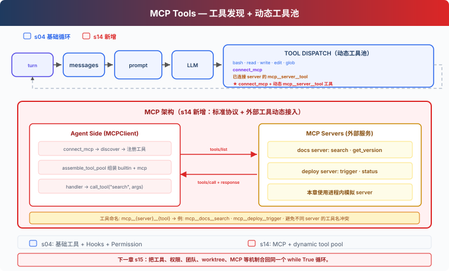

# s14: MCP Tools — 发现并调用外部工具

> ℹ️ 下面的代码片段摘自同目录 `AgentLoop.java`（有删减，完整可运行版见该文件）。
> Java 版的 MCP handler 统一是 `Function<Map<String, Object>, String>`：参数以 Map 传入，
> 而不是 Python 那样用 `**kwargs` 展开成关键字参数，所以参数校验要显式去做（见第 7 节）。

[s04](../s04_hooks/) → `s14` → [s15](../s15_integrated_harness/) → s16 → s17

> **Harness 层**：MCP Tools — 连接服务、发现工具，并把它们加入 Agent 的工具循环。

---

## 问题

前面的基础工具都直接写在 `AgentLoop.java` 里。接入文档系统和部署平台时，我们还可以继续手写 `search_docs`、`deploy_status` 和 `trigger_deploy`，但每增加一个服务，都要重新维护工具定义、参数格式和调用代码。

MCP 把这部分拆成两个角色：server 提供工具列表和调用入口，Harness 负责连接、命名、权限检查，并把发现的工具交给模型。

---

## 解决方案



本章从 s04 的五个基础工具和 Hooks 出发，增加三个部分：

- `MCPClient` 保存 server 返回的工具定义和调用入口。
- `connect_mcp` 连接一个 server，并取得它的工具列表。
- `assembleToolPool()` 把基础工具与已经连接的 MCP 工具组装到同一个工具池。

课程里的 `docs` 和 `deploy` 是进程内模拟 server，用来展示 `tools/list`、`tools/call` 和动态工具池。真实 MCP transport 不在本章实现。

---

## 工作原理

### 1. 基础 Agent Loop 不需要改变

每轮调用模型前，Harness 组装当前工具池：

```java
private static Message agentLoop(MessageCreateParams.Builder paramsBuilder, List<MessageParam> history) {
    while (true) {
        // 每轮重新组装工具池 (可能有新连接的 MCP server)
        ToolPool pool = assembleToolPool();

        MessageCreateParams.Builder pb = MessageCreateParams.builder()
                .model(MODEL).system(assembleSystemPrompt())
                .maxTokens(8000).temperature(0.3);
        pool.tools().forEach(pb::addTool);
        history.forEach(pb::addMessage);
        Message response = CLIENT.messages().create(pb.build());
        // ...
    }
}

public record ToolPool(List<Tool> tools, Map<String, Function<Map<String, Object>, String>> handlers) {}
```

连接新 server 后，下一轮 `assembleToolPool()` 会把新工具加入模型输入；`assembleSystemPrompt()` 也会在系统提示词末尾追加 `Connected MCP servers: ...`。工具执行后，结果仍作为 `tool_result` 追加到 messages。

### 2. MCPClient 保存发现结果和调用入口

```java
public record McpToolDef(String name, String description, Map<String, Object> inputSchema) {}

@FunctionalInterface
public interface McpHandler extends Function<Map<String, Object>, String> {}

static final class MCPClient {
    final String name;
    final List<McpToolDef> tools = new ArrayList<>();
    final Map<String, McpHandler> handlers = new LinkedHashMap<>();

    /** 注册工具 + handlers, 校验一致性 */
    void register(List<McpToolDef> toolDefs, Map<String, McpHandler> handlerMap) {
        Set<String> names = new HashSet<>();
        for (McpToolDef td : toolDefs) {
            if (td.name() == null || td.name().isEmpty()) {
                throw new IllegalArgumentException("Every MCP tool needs a non-empty name");
            }
            if (!names.add(td.name())) {
                throw new IllegalArgumentException("Duplicate MCP tool name on server " + this.name);
            }
            if (!handlerMap.containsKey(td.name())) {
                throw new IllegalArgumentException("Missing MCP handler: " + td.name());
            }
        }
        this.tools.addAll(toolDefs);
        this.handlers.putAll(handlerMap);
    }

    /** 运行时调用: 找到 handler, 校验参数, 执行, 返回字符串 */
    String callTool(String toolName, Map<String, Object> args) {
        McpHandler h = handlers.get(toolName);
        if (h == null) return "MCP error: unknown tool '" + toolName + "'";
        String argError = checkArgs(toolName, args);   // 见第 7 节
        if (argError != null) return argError;
        try {
            return h.apply(args);
        } catch (Exception e) {
            return "MCP error: " + e.getClass().getSimpleName() + ": " + e.getMessage();
        }
    }
}
```

`register()` 对应课程里的工具发现结果，注册时会检查工具名非空、不重复、每个工具都有 handler；`callTool()` 对应调用入口。错误会返回给模型，不会直接结束 Agent Loop。工具定义里的 schema 字段沿用 MCP 协议的写法 `inputSchema`，组装工具池时才转换成 Anthropic SDK 的 `Tool.InputSchema`。

### 3. connect_mcp 只负责连接和发现

```java
/** name → server 工厂 */
private static final Map<String, Supplier<MCPClient>> MOCK_SERVERS = Map.of(
        "docs", AgentLoop::mockServerDocs,
        "deploy", AgentLoop::mockServerDeploy
);

/** 已连接的 MCP server (server_name → client) */
private static final Map<String, MCPClient> MCP_CLIENTS = new LinkedHashMap<>();

private static String runConnectMcp(String name) {
    if (MCP_CLIENTS.containsKey(name)) {
        return "MCP server '" + name + "' already connected";
    }
    Supplier<MCPClient> factory = MOCK_SERVERS.get(name);
    if (factory == null) {
        return "Unknown server '" + name + "'. Available: "
                + String.join(", ", MOCK_SERVERS.keySet());
    }
    MCPClient server = factory.get();
    MCP_CLIENTS.put(name, server);
    String toolNames = server.tools.stream().map(McpToolDef::name)
            .reduce((a, b) -> a + ", " + b).orElse("");
    return "Connected to MCP server '" + name + "'. Discovered "
            + server.tools.size() + " tools: " + toolNames;
}
```

`connect_mcp` 工具的 `name` 参数在 schema 里用 `enum: ["docs", "deploy"]` 限定了可选值。开始时，模型只看到五个基础工具和 `connect_mcp`。调用 `connect_mcp(name="docs")` 后，Harness 保存 docs client。下一轮模型调用会看到：

```text
mcp__docs__search
mcp__docs__get_version
```

### 4. 前缀区分不同 server 的同名工具

多个 server 都可能提供 `search` 或 `status`。Harness 使用：

```text
mcp__{server}__{tool}
```

`normalizeMcpName()` 把 `[a-zA-Z0-9_-]` 以外的字符替换为下划线。组装工具池时还会检查规范化后的名称冲突和 64 字符长度限制：

```java
private static final Pattern DISALLOWED_CHARS = Pattern.compile("[^a-zA-Z0-9_-]");

private static String normalizeMcpName(String name) {
    String normalized = DISALLOWED_CHARS.matcher(name).replaceAll("_");
    if (normalized.isEmpty()) throw new IllegalArgumentException("MCP name normalizes to empty");
    return normalized;
}

// assembleToolPool() 里, 对每个已连接 server 的每个工具:
String prefixed = "mcp__" + safeServer + "__" + safeTool;
if (prefixed.length() > 64) {
    throw new IllegalArgumentException("MCP tool name longer than 64 chars: " + prefixed);
}
String origin = "MCP tool '" + serverName + "/" + rawName + "'";
if (origins.containsKey(prefixed)) {
    throw new IllegalArgumentException("MCP tool name collision after normalization: "
            + prefixed + " maps both " + origins.get(prefixed) + " and " + origin);
}
```

`origins` 一开始就登记了所有内置工具名，所以 MCP 工具也不能规范化成和内置工具同名。

因此 `docs.one/get.version` 和 `docs_one/get_version` 不会悄悄映射到同一个名字。

### 5. 工具定义和 handler 一起加入工具池

```java
// 用 Anthropic Tool.builder + JsonValue.from 把 MCP schema 转成 SDK Tool
Tool.InputSchema.Builder isb = Tool.InputSchema.builder()
        .properties(JsonValue.from(schema.getOrDefault("properties", Map.of())));
Object required = schema.get("required");
if (required != null) isb.putAdditionalProperty("required", JsonValue.from(required));
tools.add(Tool.builder()
        .name(prefixed)
        .description(td.description() == null ? "" : td.description())
        .inputSchema(isb.build())
        .build());

// handler: 闭包捕获 server + rawName, dispatch 到 server.callTool
MCPClient serverRef = server;
String toolNameRef = rawName;
handlers.put(prefixed, args -> serverRef.callTool(toolNameRef, args));

// 授权策略 (见第 6 节)
String policy = MCP_HOST_POLICY.getOrDefault(new ServerToolKey(serverName, rawName), "confirm");
MCP_TOOL_POLICIES.put(prefixed, policy);
```

模型看到带前缀的名字；handler 仍使用 server 原始工具名调用 `MCPClient`。Python 原版要用 lambda 默认参数保存当前 client 和 tool，避免循环里的 lambda 全部指向最后一个工具；Java 的 lambda 只能捕获 effectively final 的局部变量，每次循环迭代都是新的 `serverRef` / `toolNameRef`，天然没有这个问题。

### 6. 权限由宿主配置决定

MCP server 可以提供 `readOnlyHint` 或 `destructiveHint`，但这些信息来自 server，不能直接作为授权依据。本章使用宿主侧策略：

```java
private record ServerToolKey(String serverName, String toolName) {}
private static final Map<ServerToolKey, String> MCP_HOST_POLICY = Map.of(
        new ServerToolKey("docs", "search"), "allow",
        new ServerToolKey("docs", "get_version"), "allow",
        new ServerToolKey("deploy", "status"), "allow",
        new ServerToolKey("deploy", "trigger"), "confirm"    // 破坏性, 要用户确认
);
```

组装工具池时，每个 MCP 工具的策略按 `(server 原名, tool 原名)` 查出来，存进以前缀名为键的 `MCP_TOOL_POLICIES`；`permissionHook()` 再按模型调用的前缀名查这张表。未配置的外部工具默认需要用户确认：

```java
if (name.startsWith("mcp__")) {
    String policy = MCP_TOOL_POLICIES.getOrDefault(name, "confirm");
    if (!"allow".equals(policy)) {
        System.out.println("\n\033[33m[permission] External tool " + name + "(" + input + ")\033[0m");
        System.out.print("Allow? [y/N] ");
        String choice = USER_INPUT.hasNextLine() ? USER_INPUT.nextLine().trim().toLowerCase() : "";
        if (!(choice.equals("y") || choice.equals("yes"))) {
            return "Permission denied by user";
        }
    }
}
```

Java 版的 `McpToolDef` 根本没有 `readOnlyHint` / `destructiveHint` 这类字段，授权只看宿主配置；即使 description 写着 `readOnly`，也不会自动放行。

### 7. 工具输入错误留在工具边界内

模型可能漏传参数，也可能传入 server 不接受的字段。Python 原版里，`handler(**args)` 遇到这两种情况会自己抛 `TypeError`。Java 的 handler 收的是 Map，漏传的参数 `get` 出来是 `null`，多传的参数直接被忽略，所以 `MCPClient` 按工具的 `inputSchema` 显式检查：

```java
private String checkArgs(String toolName, Map<String, Object> args) {
    McpToolDef def = tools.stream().filter(t -> t.name().equals(toolName)).findFirst().orElse(null);
    if (def == null || def.inputSchema() == null) return null;
    Object props = def.inputSchema().getOrDefault("properties", Map.of());
    Object required = def.inputSchema().getOrDefault("required", List.of());
    if (required instanceof List<?> req) {
        for (Object r : req) {
            if (!args.containsKey(String.valueOf(r))) {
                return "MCP error: " + toolName + " missing required argument '" + r + "'";
            }
        }
    }
    if (props instanceof Map<?, ?> p) {
        for (String key : args.keySet()) {
            if (!p.containsKey(key)) {
                return "MCP error: " + toolName + " got an unexpected argument '" + key + "'";
            }
        }
    }
    return null;
}
```

内置工具的参数缺失或类型不对时，会抛出 `NullPointerException` / `ClassCastException`。Agent Loop 调用 handler 时把它们接住，作为 `tool_result` 返回（对应 Python `execute_tool()` 里的 `try/except`）：

```java
try {
    output = handler == null
            ? "Unknown tool: " + tb.name()
            : handler.apply(input);
} catch (Exception e) {
    output = "Error: " + e.getClass().getSimpleName() + ": " + e.getMessage();
}
```

模型收到的是这样的错误结果：

```text
MCP error: search missing required argument 'query'
Error: NullPointerException: null
```

模型可以在下一轮修正参数，而不是让课程程序直接退出。

---

## 相对 s04 的变化

| 组件 | s04 | s14 |
|---|---|---|
| 基础工具 | 五个固定工具 | 保持不变 |
| 工具来源 | `AgentLoop.java` 中的定义 | 基础工具加动态发现的 MCP 工具 |
| 工具池 | 固定 `TOOLS` | 每轮由 `assembleToolPool()` 组装 |
| 外部工具名 | 无 | `mcp__{server}__{tool}` |
| 权限 | Shell 和路径检查 | 增加宿主侧 MCP 策略 |
| MCP transport | 无 | 使用进程内模拟 server 展示协议边界 |

本章不带入 Task、Background、Cron、Team 或 Worktree。它们会在 s15 的 Integrated Harness 中与 MCP 合并。

---

## 试一下

```sh
cd learn-claude-code-java
mvn -q compile exec:java -Dexec.mainClass=com.learn.cc.s14_mcp_plugin.AgentLoop
```

输入：

```text
连接 docs server，搜索 agent hooks，并告诉我当前文档 API 版本。
```

一次典型工具轨迹是：

```text
connect_mcp(name="docs")
mcp__docs__search(query="agent hooks")
mcp__docs__get_version()
```

再输入：

```text
连接 deploy server，查看 web 服务状态，不要触发部署。
```

`status` 会按宿主策略直接执行；`trigger` 需要用户确认。

---

## 接下来

目前，MCP 还是一条独立的课程分支。s15 Integrated Harness 会把基础工具、Hooks、Skills、Context、Memory、Task、Background、Cron、Teams 和 MCP 放进同一个运行时。

<!-- translation-sync: zh@v9, en@v9, ja@v9 -->
