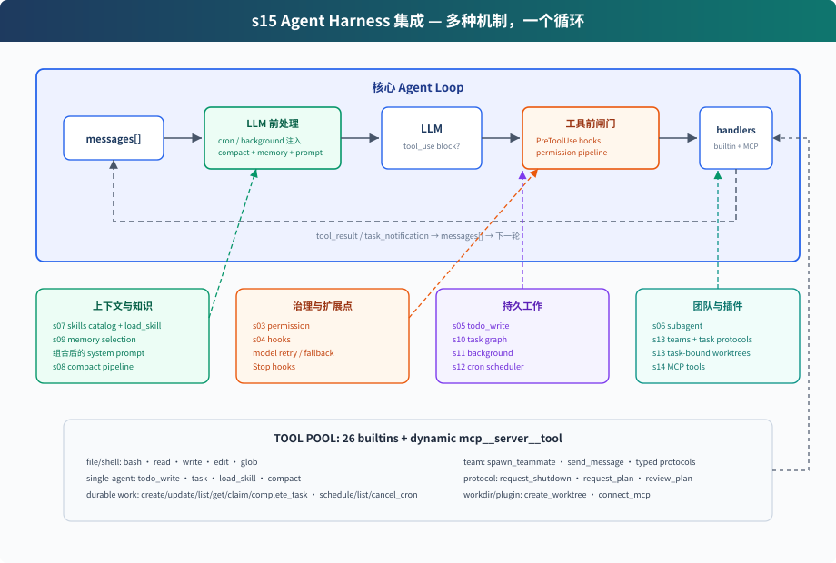

# s15: Agent Harness 集成 — 多种机制，一个循环

> ℹ️ 下面的代码片段摘自同目录 `AgentLoop.java`（有删减，完整可运行版见该文件）。
> 本章 Java 版是**整合示范**：Python 原版约 3300 行，是把前面所有能力完整集成的运行时；Java 版约 1300 行，
> 只把每个机制的最小骨架挂到同一个循环上，让你看清多种机制如何在同一个 `while (true)` 里协同。
> 正文按 Java 的实际功能来写，每一节末尾的「和 Python 原版的差别」列出没有带过来的部分。

s01 → ... → s13 → [s14](../s14_mcp_plugin/) → `s15` → [s16](../s16_workflow_runtime/) → s17

> *"多种机制，一个循环"* — 工具、权限、记忆、任务、团队、插件都挂在同一个 while True 上。
>
> **Harness 层**: 集成 — 把本章示例实际使用的机制放进同一个可运行系统。

---

## 问题

前面的章节把不同机制放在各自独立的示例中。本章把集成运行时需要的机制接到一起。

一个能长期工作的 coding agent 需要同时拥有：

- 工具分发和权限边界
- hooks 扩展点
- todo 计划和任务图
- 技能、记忆、系统 prompt 组装
- 压缩和错误恢复
- 后台任务和 cron 调度
- 团队、协议和 idle 任务认领
- 任务绑定的 worktree
- MCP 外部工具接入

S15 不再引入一个独立机制，而是展示现有机制从哪里进入模型循环，以及它们产生的事件如何回到同一段对话。

---

## 解决方案



S15 不再引入新机制，而是把前面各章的组件集成到同一个 harness。Java 版一轮的顺序是：

```text
用户输入（或 cron / 后台 / 队友事件自动唤醒）
  → [hook] UserPromptSubmit（只打印一行日志）
  → 后台通知 + cron prompt + team events 注入 messages
  → compact（字符阈值，保头保尾）
  → memory recall + skills catalog + MCP 状态组装 system prompt
  → 每轮重新组装工具池（内置工具 + 已连接的 MCP 工具）
  → LLM
  → stop_reason == tool_use?
      否 → [hook] Stop（只打印一行日志）→ 返回
      是 → permissionCheck（bash deny-list）
          → 后台 bash / 工具池 handler（含 mcp__ 工具）
          → [hook] PostToolUse（大输出告警）
          → todo reminder
          → tool_result 回 messages → 下一轮
```

循环仍是同一个结构：调用模型，检查是否需要执行工具，执行工具，再把结果追加回 `messages`。Java 版用响应的 `stop_reason` 是否为 `tool_use` 决定是否继续工具轮。

---

## 组件在循环中的位置

| 位置 | 组件 | Java 版的作用 |
|------|------|------|
| 用户输入后 | `UserPromptSubmit` hook | 打印一行日志（没有可注册的 hook 框架） |
| LLM 前 | background notifications | 已完成的后台 bash 以 `<task_notification>` 注入 |
| LLM 前 | cron queue | 到点的 prompt 以 `[Scheduled] ...` 注入 |
| LLM 前 | team events | Lead 收件箱里的队友消息以 `[Team events]` 注入 |
| LLM 前 | compaction | 估算字符数超过 40,000 且消息超过 10 条时，保头保尾、中间换成一条占位消息 |
| LLM 前 | memory / skills / MCP state | 组装 system prompt |
| LLM 调用 | 错误处理 | 调用抛异常就打印错误、结束本轮；只依赖 SDK 客户端自带的自动重试 |
| 工具执行前 | `permissionCheck` | bash 命令命中 deny-list 就拒绝 |
| 工具分发 | `assembleToolPool()` | 每轮组装内置工具和 MCP 动态工具 |
| 工具执行时 | background dispatch | `run_in_background=true` 的 bash 放进 daemon 线程，先返回占位结果 |
| 工具执行后 | `PostToolUse` hook | 输出超过 100,000 字符时打印告警 |
| 工具执行后 | todo reminder | 连续 3 轮没调用 `todo_write` 就追加 `<reminder>` |
| 本轮没有 tool_use | `Stop` hook | 打印一行日志 |

---

## AgentLoop.java 包含什么

### 工具与分发

内置工具池包含 15 个工具：

```text
bash, read_file, write_file, edit_file, glob
todo_write, load_skill
create_task, list_tasks, claim_task, complete_task
schedule_cron
spawn_teammate, list_teammates
connect_mcp
```

`assembleToolPool()` 每轮组装内置工具和 handler，再把已连接 MCP server 的工具加进去：

```java
private static ToolPool assembleToolPool() {
    List<Tool> tools = new ArrayList<>(BUILTIN_TOOLS);
    Map<String, Function<Map<String, Object>, String>> handlers = new LinkedHashMap<>();
    handlers.put("bash", args -> runBash((String) args.get("command")));
    handlers.put("read_file", args -> runRead((String) args.get("path"), asInt(args.get("limit"))));
    // ... 其余 13 个内置工具

    // MCP 工具动态加入
    for (Map.Entry<String, MCPClient> e : MCP_CLIENTS.entrySet()) {
        String serverName = e.getKey();
        MCPClient server = e.getValue();
        for (McpToolDef td : server.tools) {
            String prefixed = "mcp__" + serverName + "__" + td.name();
            // ... MCP inputSchema → SDK Tool.InputSchema
            tools.add(Tool.builder().name(prefixed).description(td.description()).inputSchema(isb.build()).build());
            String tn = td.name();
            handlers.put(prefixed, args -> server.callTool(tn, args));
        }
    }
    return new ToolPool(tools, handlers);
}
```

所以 `connect_mcp("docs")` 后，下一轮工具池里会出现 `mcp__docs__search`。

> 和 Python 原版的差别：Python 有 26 个内置工具。Java 版没有一次性 subagent `task`、手动 `compact`、`update_task` / `get_task`、`list_crons` / `cancel_cron`、`send_message`、`request_shutdown` / `request_plan` / `review_plan` 和 `create_worktree`。

### 权限和 hooks

Java 版没有 s04 那样可注册回调的 hook 框架。权限是工具执行前直接调用的一个函数：

```java
private static String permissionCheck(ToolUseBlock block, Map<String, Object> input) {
    String name = block.name();
    if ("bash".equals(name)) {
        String cmd = (String) input.getOrDefault("command", "");
        for (String p : DENY_LIST) if (cmd.contains(p)) {
            return "Permission denied by deny list";
        }
    }
    if (name.startsWith("mcp__")) {
        // 简化: 所有 MCP 工具都放行 (s14 有 host policy 表)
    }
    return null;
}
```

执行工具时，权限检查、后台分发和普通分发包在同一个 `try` 里。参数缺失或类型不对抛出的异常会变成 `tool_result`，不会让整个程序退出：

```java
String blocked = permissionCheck(tb, input);
String output;
try {
    if (blocked != null) {
        output = blocked;
    } else if ("bash".equals(tb.name()) && Boolean.TRUE.equals(input.get("run_in_background"))) {
        output = "Background task " + bgStart(tb, (String) input.get("command"))
                + " started. Result arrives as <task_notification>.";
    } else {
        var handler = pool.handlers().get(tb.name());
        output = handler == null ? "Unknown tool: " + tb.name() : handler.apply(input);
    }
} catch (Exception e) {
    output = "Error: " + e.getClass().getSimpleName() + ": " + e.getMessage();
}
```

`UserPromptSubmit`、`PostToolUse` 和 `Stop` 都只是在对应位置打印日志，`PostToolUse` 额外检查输出是否超过 100,000 字符。

> 和 Python 原版的差别：Python 把权限挂在 `PreToolUse` hook 上，Lead、subagent 和队友的工具都会经过它。Python 还有这几条规则：MCP 工具只有宿主名单里的只读工具直接放行，其余都要询问用户；文件工具越过 `WORKDIR` 直接拒绝；每条 bash 命令执行前都会询问；异步轮次直接拒绝需要确认的操作。Java 版只有 bash deny-list，MCP 工具全部放行，文件工具不检查路径越界，也没有任何交互确认。

### 计划与任务

S15 同时保留两层计划：

- `todo_write`：当前会话内的轻量计划，保存在内存里的 `TODOS`，每次整表替换
- task graph：写入 `.tasks/task_*.json` 的任务文件，有稳定 ID 和单条状态更新

前者帮助单个 Agent 不漂移，后者支撑跨会话和团队协作。连续 3 轮工具调用都没有 `todo_write` 时，循环会在 tool_result 后面追加一条提醒：

```java
if (usedTodo) ROUNDS_SINCE_TODO = 0;
else ROUNDS_SINCE_TODO++;
if (ROUNDS_SINCE_TODO >= 3) {
    results.add(ContentBlockParam.ofText(TextBlockParam.builder()
            .text("<reminder>Update your todos.</reminder>").build()));
    ROUNDS_SINCE_TODO = 0;
}
```

> 和 Python 原版的差别：Java 版的任务工具只有 `create_task`、`list_tasks`、`claim_task` 和 `complete_task`，没有 `update_task`，所以任务之间不能建立 `blockedBy` 依赖，也就没有 s10 的两阶段建图。`claim_task` 一律把 owner 记成 `agent`，队友认领时也是如此。

### 子 agent 与团队

`spawn_teammate` 启动一个 daemon 线程。传入 `task_id` 时，它先认领任务，再调用**一次**模型，然后完成任务，把结果发到 Lead 收件箱后退出：

```java
Thread t = new Thread(() -> {
    try {
        String initPrompt = prompt;
        if (taskId != null) {
            runClaimTask(taskId);
            Task tk = loadTask(taskId);
            initPrompt += "\n[Assigned task " + tk.id() + "] " + tk.subject() + "\n" + tk.description();
        }
        // 极简: 单轮 LLM 调用 + 报告结果
        MessageCreateParams params = MessageCreateParams.builder()
                .model(MODEL).system("You are '" + name + "', a " + role
                        + ". Do the task briefly and report back concisely.")
                .maxTokens(2000).temperature(0.3)
                .addUserMessage(initPrompt).build();
        Message resp = CLIENT.messages().create(params);
        String text = /* resp 里的全部 text */;
        if (taskId != null) runCompleteTask(taskId);
        BUS.send(name, "lead", text.isEmpty() ? "(done)" : text, "result", null);
    } catch (Exception e) {
        BUS.send(name, "lead", e.getMessage(), "error", null);
    } finally {
        ACTIVE_TEAMMATES.remove(name);
    }
}, "teammate-" + name);
```

`MessageBus` 和 s13 一样，每个 Agent 一个 `.mailboxes/<name>.jsonl` 收件箱，每条消息写成一行 JSON。Lead 启动队友后结束当前轮次；队友结果进入 Lead 收件箱后，主循环会自动唤醒下一轮（见「后台和 cron」一节）。

> 和 Python 原版的差别：Python 有两种 delegation。一种是一次性 subagent `task`，有独立 `messages[]`，只返回最终摘要。另一种是持久队友，按 `WORK → result → IDLE` 循环运行，带文件和 Shell 工具，IDLE 时等消息或原子认领就绪任务，还支持关机和计划审批协议。Java 版没有 subagent。队友只调用一次模型、不带任何工具、做完就退出，也没有协议。

### 记忆、技能和 prompt

每轮调用模型前，`assembleSystem()` 拼出 system prompt：身份说明、skills catalog、memory catalog、按当前请求召回的相关记忆，以及已连接的 MCP server。

```java
private static String assembleSystem(String recallHint) {
    StringBuilder sb = new StringBuilder();
    sb.append("You are the Lead coding agent at ").append(WORKDIR).append(". Act, don't explain.\n");
    sb.append("You have s01-s14 abilities: tools, permissions, todos, skills, memory, tasks, "
            + "background bash, cron, teammates, MCP.\n");
    String sc = skillCatalog();
    if (!sc.isEmpty()) sb.append("\n").append(sc);
    String mc = memoryCatalog();
    if (!mc.isEmpty()) sb.append("\n").append(mc);
    if (!recallHint.isEmpty()) sb.append("\n").append(recallHint);
    if (!MCP_CLIENTS.isEmpty()) sb.append("\nConnected MCP servers: ").append(String.join(", ", MCP_CLIENTS.keySet()));
    return sb.toString();
}
```

技能只放目录，完整内容通过 `load_skill(name)` 按需加载。记忆召回由 `memoryRecall(query)` 完成：从请求里取英文单词和中文词，按命中数给 `.memory/*.md` 打分，取前 3 条，把正文放进 system prompt。cron、后台或队友事件触发的唤醒轮次没有新的用户输入，召回沿用上一条用户请求。

> 和 Python 原版的差别：Python 直接复用 s09 的 Memory runtime，先让模型选择相关记录，失败后才降级为关键词匹配；本轮结束后还会 `extract_memories()` 提取新记忆，并在需要时 `consolidate_memories()`。Java 版只有关键词召回，不会自动写入或整理记忆，`.memory/` 里的内容需要事先准备好。

### 压缩和恢复

LLM 调用前先跑 `maybeCompact()`。估算的字符数超过 40,000 且消息超过 10 条时，保留开头 3 条和最后 5 条，中间换成一条 `[N earlier messages elided by compaction]`。切口会做对齐，不会把 `tool_use` 和它的 `tool_result` 拆开：

```java
int head = 3, tailStart = history.size() - 5;
// 切口不能把 tool_use 和它的 tool_result 拆开 (对齐 s08 snipCompact)
if (hasToolUse(history.get(head - 1))) {
    while (head < tailStart && isToolResultMsg(history.get(head))) head++;
}
if (isToolResultMsg(history.get(tailStart)) && hasToolUse(history.get(tailStart - 1))) tailStart--;
if (head >= tailStart) return history;
List<MessageParam> out = new ArrayList<>(history.subList(0, head));
out.add(MessageParam.builder().role(MessageParam.Role.USER)
        .content("[" + (tailStart - head) + " earlier messages elided by compaction]").build());
out.addAll(history.subList(tailStart, history.size()));
```

拆开的配对会让 API 拒绝整段历史。坏掉的历史会一直留在会话里，所以之后每一轮都会失败。

> 和 Python 原版的差别：Python 跑完整的 s08 四步管线（`tool_result_budget → snip_compact → micro_compact → compact_history`），会归档完整历史、保存大输出、必要时生成摘要。模型调用还会再包一层恢复：429 / 529 指数退避（529 连续失败可切 fallback model）、`max_tokens` 升级加 continuation、prompt too long 时 reactive compact。Java 版的压缩直接丢掉中间消息，不归档也不摘要。字符数估算也很粗：block 形式的消息每个 block 按 200 字符计，大的工具输出几乎不会触发压缩。模型调用出错时只打印错误并结束本轮，依赖 SDK 客户端自带的自动重试。

### 后台和 cron

bash 调用设置 `run_in_background=true` 后，主循环不等命令结束，而是先返回占位结果：

```text
run_in_background=true → bgStart → 占位 tool_result
后台完成 → BG_READY → 下一轮 bgCollect() 注入 <task_notification>
```

cron 调度线程每秒检查一次，表达式匹配且本分钟还没触发过，就把任务放进 `CRON_QUEUE`；下一轮开始时以 `[Scheduled] <prompt>` 注入。

这些异步事件到达时不需要用户输入。主线程和 s13 一样，把阻塞读 stdin 的工作交给一个 daemon 线程，自己交替检查「有没有异步事件」和「有没有用户输入」：

```java
/** 只看不取: agentLoop 开头才真正 consume 这三类事件 */
private static boolean hasPendingEvents() {
    CRON_LOCK.lock();
    try { if (!CRON_QUEUE.isEmpty()) return true; } finally { CRON_LOCK.unlock(); }
    BG_LOCK.lock();
    try { if (!BG_READY.isEmpty()) return true; } finally { BG_LOCK.unlock(); }
    return BUS.peek("lead");
}

private static CliEvent waitForCliEvent() {
    boolean promptVisible = false;
    while (true) {
        if (hasPendingEvents()) {
            if (promptVisible) System.out.println();
            return new CliEvent("wake", null);
        }
        if (!promptVisible) { System.out.print("\033[36ms15v >> \033[0m"); promptVisible = true; }
        Optional<String> line;
        try { line = CLI_INPUT.poll(250, TimeUnit.MILLISECONDS); }
        catch (InterruptedException e) { /* ... */ return new CliEvent("quit", null); }
        if (line == null) continue;                              // 超时: 回去看异步事件
        if (line.isEmpty()) return new CliEvent("quit", null);   // stdin EOF
        return new CliEvent("user", line.get());
    }
}
```

`main` 拿到 `wake` 时直接开一轮；事件本身由 `agentLoop` 开头的 `bgCollect()`、`consumeCronQueue()` 和 `consumeLeadInbox()` 取出并注入。

> 和 Python 原版的差别：
> - **后台 bash**：Python 的每条 Shell 命令在独立进程组中运行，退出时会清理。Java 版没有进程清理，后台输出截到 5,000 字符，通知摘要截到 300 字符。
> - **cron**：Python 有 durable 任务和 `pending_delivery`，模型调用失败会放回队列，交付语义是至少一次。Java 版的 cron 只存在内存里，进程退出就消失；任务一取出就离开队列，调用失败也不会放回，属于至多一次。`schedule_cron` 只检查字段个数，也没有 `list_crons` / `cancel_cron`。

### worktree 与 MCP

Java 版没有 worktree 机制。所有工具都在 `WORKDIR` 下运行，队友本身也不带文件或 Shell 工具。

MCP 沿用 s14 的思路，但更简化：

- `connect_mcp("docs")` 连接进程内 mock server，它只有一个 `search` 工具
- `assembleToolPool()` 把 MCP 工具组装进工具池，工具名统一为 `mcp__server__tool`

> 和 Python 原版的差别：Python 的 s15 从 s13 继承了任务绑定的 worktree：Lead 可以 `create_worktree(name, task_id)`，认领任务后队友的文件工具切到对应目录，移除留给宿主。Python 的 MCP 还有名称规范化、冲突检查和宿主授权策略。Java 版的 MCP 不做名称规范化和冲突检查，不检查参数，也没有授权策略。

---

## 相对 s14 的变化

| 范围 | s14 MCP | s15 Integrated Harness（Java） |
|------|---------|-------------------------|
| 内置工具 | 6 个 | 15 个 |
| 外部工具 | 已连接的 MCP 工具（docs、deploy） | 已连接的 MCP 工具（只有 docs），全部放行 |
| 本地机制 | S04 工具、hooks、权限和 MCP | todo、skills、compaction、memory recall、task 文件、后台 bash、cron、单次调用的队友 |
| 事件来源 | 用户输入和工具结果 | 用户输入、工具结果、cron prompt、后台通知和 team events，后三者会自动唤醒新一轮 |

---

## 试一下

```sh
cd learn-claude-code-java
mvn -q compile exec:java -Dexec.mainClass=com.learn.cc.s15_integrated_harness.AgentLoop
```

可以试：

1. `检查这个仓库，告诉我哪些 Java 文件最重要。`
2. `连接 docs server，查一下 agent loop 的相关说明。`
3. `创建一个“整理 README”的任务，让队友 bob 去完成，完成后告诉我结果。`
4. `3 分钟后提醒我开会。`
5. `在后台运行 sleep 5 && ls，同时读一下 README.md。`

观察重点：

- bash 命令命中 deny-list 时是否被拒绝
- `connect_mcp` 后下一轮是否出现 `mcp__docs__search`
- 设置 `run_in_background=true` 的 bash 调用是否先返回占位结果，完成后是否不用输入就出现 `[wake: ...]`
- 到点后是否不用输入就自动提醒开会
- 队友 bob 的结果是否自动回到 Lead
- 连续 3 轮没更新 todo 时是否出现 `[nag] reminder injected`

---

## 接下来

[s16 Workflow Runtime](../s16_workflow_runtime/) 会在这个 host 中加入 `Workflow` 工具。Workflow 把固定的编排路径写在代码中，并记录运行进度，使同一次运行可以继续执行。

<!-- translation-sync: zh@v14, en@v14, ja@v14 -->
