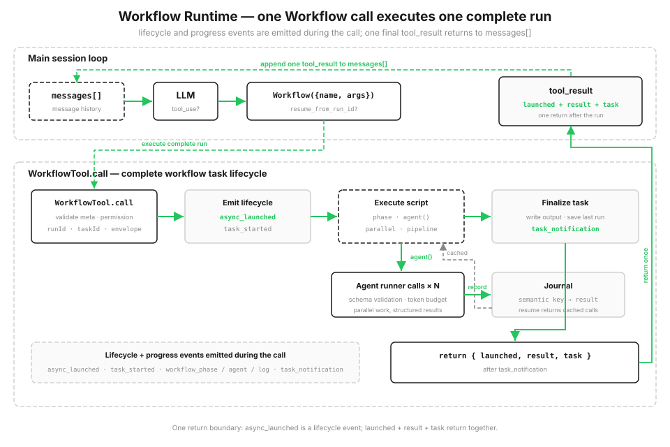

# s16: Workflow Runtime — 模型决定单步，脚本决定编排

> ℹ️ 下面的代码片段摘自同目录 `AgentLoop.java`（有删减，完整可运行版见该文件）。
> Python 用 `async/await` + `asyncio.gather` 表达并发；Java 17 没有 async/await，改用 `CompletableFuture`：
> `agent()` 返回 `CompletableFuture<Object>`，`parallel` / `pipeline` 用 `allOf` 汇总，实际调用跑在一个 4 线程的 `ExecutorService` 上。

s01 → ... → s14 → [s15](../s15_integrated_harness/) → `s16` → [s17](../s17_goal_loop/)

> *"一次 tool_use，跑完一整套编排"* — `Workflow` 工具启动一个可恢复的脚本运行时，协调多次 agent 调用。
>
> **Harness 层**: 编排 — 在单 agent 循环之上，执行保存好的多 agent 脚本。

---

从 s01 到 s15，每一轮都由模型决定调用哪些工具。工具结果进入 `messages[]` 后，模型再根据更新后的上下文决定下一步。当后续路径取决于上一步发现了什么时，这种方式很合适。

有些任务会重复一套固定流程。例如代码审查可以同时检查多个维度，再逐条验证发现、合并重复项并按严重程度排序。执行前已经知道步骤及其先后关系，这时宿主需要三样东西：

- **并行**，别一个一个串着等；
- **稳定的结果结构**，即使每个 agent 的回答会变化；
- **可恢复**，跑到一半断了，已经做完的部分别从头再来。

如果这套编排只存在于对话历史里，步骤顺序和检查点也只存在于历史里。保存好的 workflow 把固定流程写进代码，并在 journal 中记录已经完成的调用。

## 计划写在代码里，不是靠聊天一轮轮凑

在 harness 的工具池里加入一个 `Workflow` 工具。宿主注册由 `agent() / parallel() / pipeline() / phase()` 组成的可信脚本。模型只提供保存好的 workflow 名称、参数和可选的续跑 run ID，不会提交可执行代码或元数据。

workflow 以一次 `tool_use` 进入主循环。脚本运行时，runtime 会发出生命周期和进度事件，并把每一步写进磁盘上的 journal。脚本结束后，这次调用返回启动信息、结果和任务状态。脚本里的中间结果存在变量里，不会塞进对话历史。下次用 `resume_from_run_id` 重启时，没改过的 `agent()` 会直接使用 journal 中的结果。



```java
// 宿主注册: 元数据 + 脚本函数
Map<String, Object> meta = Map.of(
        "name", "review-changes",
        "description", "Review changed files across dimensions, verify each finding",
        "phases", List.of("Review", "Verify"));
WORKFLOWS.put("review-changes", new RegisteredWorkflow(meta, AgentLoop::sampleWorkflowReview));

// 脚本本体: (ctx, args) -> CompletableFuture<result>
private static CompletableFuture<Object> sampleWorkflowReview(WorkflowContext ctx, Map<String, Object> args) {
    ctx.phase("Review");
    // ... audit / verify 两个 stage, 见「跑起来看看」
    return ctx.pipeline(DIMENSIONS, List.of(audit, verify)).thenApply(results -> {   // 每个维度独立走 审计 → 验证
        List<Map<String, Object>> confirmed = /* 汇总各维度 confirmed, 按 severity 排序 */;
        ctx.log("confirmed " + confirmed.size() + " real finding(s)");
        return (Object) Map.of("confirmed", confirmed);
    });
}
```

## Workflow 工具：一次调用，完成整次运行

用户可以要求运行一个保存好的 workflow，模型也可以在任务匹配已知编排时选择这个工具。适配器会用名称查询宿主管理的 `WORKFLOWS` registry，再把可信的元数据和函数交给运行时。

模型可见的 schema 只接受 `name`、`args` 和 `resume_from_run_id`。名称未知或参数格式错误时，适配器会返回错误工具结果，不会让宿主循环退出。随后运行时校验已经注册的元数据，并在执行脚本前发出 `async_launched`。进度事件和最终的 `task_notification` 随后到达；调用返回 JSON 格式的启动信息、结果和任务状态。

```java
tool("Workflow", "Run a saved workflow by name. Pass input in args.",
        Map.of("name", Map.of("type", "string"),
               "args", Map.of("type", "object"),
               "resume_from_run_id", Map.of("type", "string")),
        List.of("name")),

private static String runWorkflow(String name, Object argsObj, String resumeFromRunId) {
    if (name == null) return "Error: workflow name required";
    RegisteredWorkflow reg = WORKFLOWS.get(name);
    if (reg == null) return "Error: unknown workflow '" + name + "'. Available: "
            + String.join(", ", WORKFLOWS.keySet());
    Map<String, Object> args = (argsObj instanceof Map<?, ?> m) ? new LinkedHashMap<>((Map<String, Object>) m) : Map.of();
    try {
        Map<String, Object> out = workflowCall(reg.meta(), reg.script(), args, resumeFromRunId);
        return JSON_MAPPER.writerWithDefaultPrettyPrinter().writeValueAsString(out);   // {launched, result, task}
    } catch (Exception e) {
        return "Error: " + e.getClass().getSimpleName() + ": " + e.getMessage();
    }
}
```

Agent Loop 调用 `dispatchTool` 时也包了一层 `try/catch`，比如 `name` 传成数字导致的 `ClassCastException` 会作为 `tool_result` 返回，不会让程序退出。

> 和 Python 原版的差别：Python 的 `Workflow` 加在 s15 宿主的完整工具池里，执行前还要经过权限检查。Java 版的 s16 是一个只装了 `Workflow` 和 `list_workflows` 两个工具的最小循环，没有权限检查。schema 里也没有 `additionalProperties: false`，多余字段不会被拒绝。

## Workflow 元数据：启动前先校验

每个保存好的 workflow 都会注册一份可信元数据，包含 `name`、`description` 和可选的 `phases`。运行时会在执行 workflow 代码前校验它：`name` 和 `description` 用来标识任务，`phases` 给进度显示分组命名。这些字段属于宿主 registry，不是模型输入。

注册内容不合法时，运行时会在启动前抛出 `IllegalArgumentException`（Python 原版是 `WorkflowInputError`）。这和 s12 校验 cron 表达式是一个思路：保存好的 workflow 有问题，就不要等到执行时才发现。

运行时会把 `meta.name` 用在本地产物文件名中，因此还要求它是 1-64 个字符的安全 slug，只能包含字母、数字、`.`、`_`、`-`。

```java
private static final Pattern SAFE_NAME = Pattern.compile("^[A-Za-z0-9._-]{1,64}$");

private static void validateMeta(Map<String, Object> meta) {
    String name = String.valueOf(meta.get("name"));
    if (!SAFE_NAME.matcher(name).matches())
        throw new IllegalArgumentException("meta.name must be 1-64 chars [A-Za-z0-9._-]");
    if (!(meta.get("description") instanceof String))
        throw new IllegalArgumentException("meta.description must be a string");
}
```

> 和 Python 原版的差别：Java 版不校验 `phases`，也不检查 `description` 是否为空字符串。

## 编排原语

脚本收到一个只暴露少量编排原语的 `WorkflowContext`，本身不直接读写文件，也不运行 shell。`agent()` 实际交给哪个 `WorkflowRunner` 执行，由 `RUNNER_FACTORY` 决定：

```java
/** 默认用 Mock runner (安全, 无成本), 想真跑改成 AnthropicRunner */
private static final Supplier<WorkflowRunner> RUNNER_FACTORY = MockRunner::new;
```

`MockRunner` 不调用模型，按 label 返回固定的演示数据（每个审查维度报 2 条 finding，验证结果按 label 的哈希值决定真假），便于重复观察事件和 journal。`AnthropicRunner` 用与宿主相同的 API client 真实调用模型，每个子 agent 只读取 workflow 参数中提供的内容。

| 原语 | 作用 |
|------|------|
| `agent(prompt, schema, label)` | 派一个子 agent 干活，返回 `CompletableFuture<Object>` |
| `parallel(thunks)` | **等齐屏障**：所有任务并行跑完，一起等结果回来 |
| `pipeline(items, stages)` | 每个 item 分阶段跑，**不等齐**，跑完一个往下走一个 |
| `phase(title)` | 标记当前进度阶段（更新进度条） |
| `log(message)` | 打一行进度日志 |

同时运行的 agent 最多 4 个（`Semaphore`），一次运行最多调用 32 次 `agent()`；`args.budget` 可以给出 token 上限。

> 和 Python 原版的差别：Python 默认交互模式就用真实 API，`MockAgentRunner` 只用于 `demo` 和单元测试；Java 版默认是 `MockRunner`，要真实调用需要把 `RUNNER_FACTORY` 改成 `AnthropicRunner::new`。Java 版也没有嵌套子工作流的 `workflow(name, args)` 原语，`agent()` 不接受 `phase` 参数。

每个 item 都要独立经过相同步骤时，可以使用 `pipeline`。item A 跑到第 3 阶段时，item B 可能还在第 1 阶段；下一步必须同时使用上一阶段全部结果时，再使用 `parallel` 等待所有调用完成。

```java
public <T> CompletableFuture<List<Object>> pipeline(List<T> items, List<PipelineStage> stages) {
    List<CompletableFuture<Object>> perItem = new ArrayList<>();
    for (int i = 0; i < items.size(); i++) {
        final int idx = i;
        final T item = items.get(i);
        CompletableFuture<Object> chain = CompletableFuture.completedFuture((Object) item);
        for (PipelineStage stage : stages) {                      // 每个 item 独立跑完所有 stage
            chain = chain.thenCompose(prev -> stage.apply(prev, item, idx));
        }
        perItem.add(chain);
    }
    return CompletableFuture.allOf(perItem.toArray(new CompletableFuture[0]))
            .thenApply(v -> perItem.stream().map(CompletableFuture::join).toList());
}

public CompletableFuture<List<Object>> parallel(List<Supplier<CompletableFuture<Object>>> thunks) {
    List<CompletableFuture<Object>> futures = new ArrayList<>();
    for (Supplier<CompletableFuture<Object>> t : thunks) futures.add(t.get());
    return CompletableFuture.allOf(futures.toArray(new CompletableFuture[0]))   // 等齐屏障
            .thenApply(v -> futures.stream().map(CompletableFuture::join).toList());
}
```

`thenCompose` 把同一个 item 的各个 stage 串成一条链，不同 item 的链互不等待；只有最外层的 `allOf` 才等所有 item 完成。

## 结构化输出：别让子 agent 回来写散文

`agent(prompt, schema, label)` 带上 schema 时，会要求子 agent 只返回 JSON 对象。这样下游代码拿到的是对象，不必再从自然语言中提取字段。

s05 就说过，工具的参数不能全信；这里是同一个道理反过来：子 agent 的输出也不能全信。Python 原版会用 schema 校验结果，不符合就提醒一次重试，再不对就报错，把不确定性挡在编排层外面。

Java 版只做到了第一步。`AnthropicRunner` 在 system prompt 里要求只返回 JSON，再从回复里截取第一个 `{` 到最后一个 `}` 之间的内容解析：

```java
String system = "You are a specialized worker agent. "
        + (schema != null ? "Return ONLY valid JSON matching the required schema. " : "")
        + "Label: " + label;
// ... 调用模型, 拼出回复文本 text
Object value = text;
if (schema != null) {
    try {
        int i = text.indexOf('{');
        int j = text.lastIndexOf('}');
        if (i >= 0 && j > i) {
            value = JSON_MAPPER.readValue(text.substring(i, j + 1), new TypeReference<Object>() {});
        }
    } catch (Exception ignore) {}
}
```

> 和 Python 原版的差别：Java 版不按 schema 校验，也不重试（`agent()` 的注释写着「schema 校验略过（教学简化）」）。解析失败时返回的是原始文本，示例 workflow 把它当 `Map` 用就会失败，整次运行标记为 `failed`。默认的 `MockRunner` 总是返回合法结构，所以演示时不会遇到。

## 任务状态和进度事件

`WorkflowTask` 维护状态和 token 用量，向外发一条 SDK 风格的事件流：`async_launched` → `task_started` → 一串进度事件（`workflow_phase` 阶段切换、`workflow_agent` 子 agent 完成或命中缓存、`workflow_log` 日志）→ 最后一个 `task_notification`（完成或失败，带输出文件、agent 数和 token 数）。

演示会按顺序打印这些事件，并在最终通知后返回任务状态。

```java
/** agent 完成时由 wf-worker 线程调用; usage 是普通 LinkedHashMap, 并发 merge 会丢更新, 所以加锁 */
synchronized void addUsage(int tokens) {
    usage.merge("agents", 1, Integer::sum);
    usage.merge("tokens", tokens, Integer::sum);
}

// 多个 wf-worker 线程会同时发进度事件, progress 是普通 ArrayList, 所以加 synchronized
synchronized void progressEvent(String type, Map<String, Object> data) {   // 阶段/子agent/日志
    Map<String, Object> rec = new LinkedHashMap<>();
    rec.put("type", type); rec.putAll(data);
    progress.add(rec);
    System.out.println("  progress   " + String.format("%-16s", type) + /* k=v ... */);
}
```

多个 agent 在不同的工作线程上并发完成，所以用量和进度的更新都要加锁。

## 存储：快照 + journal，断了能续

运行时把每次运行的数据存在工作目录下的 `.runtime/`：快照 `<runId>.json`、输出 `<runId>.output.json` 和 journal `<runId>.journal.jsonl`。`runId` 形如 `run_<workflow 名>_<毫秒时间戳>_<随机数>`。快照记录 workflow 名称、参数和任务状态。

journal 是断点续跑的核心，它一条一条记下来每个 `agent()` 的结果：

```java
// cached / record 会被多个 wf-worker 线程同时调用, cache 是普通 LinkedHashMap, 所以加 synchronized
synchronized void record(String key, Object value) throws IOException {
    Map<String, Object> rec = new LinkedHashMap<>();
    rec.put("key", key); rec.put("value", value);
    // 必须写成单行: JSON_MAPPER 全局开了 INDENT_OUTPUT, 直接 writeValueAsString 会输出多行 JSON,
    // 破坏 jsonl "一行一条记录" 的格式, resume 时逐行解析全部失败, 缓存一条都读不回来, 所有 agent 重跑
    Files.writeString(path, JSON_MAPPER.writer().without(SerializationFeature.INDENT_OUTPUT)
                    .writeValueAsString(rec) + "\n",
            StandardOpenOption.CREATE, StandardOpenOption.APPEND);
    cache.put(key, value);
}
```

resume 时，`WorkflowJournal` 的构造函数逐行读回这些记录放进 `cache`；新运行则把 journal 清空。`resume_from_run_id` 来自模型，会被拼进文件路径，所以先用 `RUN_ID` 正则校验格式，防止 `../..` 这类值把文件写到 `.runtime/` 之外。

> 和 Python 原版的差别：Python 会用排他式文件创建预留新的 `runId`，还有协调文件 `<runId>.lock`。整次执行和最终持久化期间都持有这个 run lock，另一个进程不能同时 resume 同一次运行；resume 前还会先验证已保存的快照和 journal。Java 版这几项都没有：resume 只要求 journal 文件存在，快照和输出会被直接覆盖。

## resume：用 runId 续跑，没改的直接用缓存

带着 `resume_from_run_id` 再次调用 workflow 时，脚本会重新执行，但每个 `agent()` 都会计算一个确定的语义 key：key 在 journal 里有记录，就直接返回缓存结果；只有改过的调用以及依赖它的后续步骤才会真的运行。

这里有个关键点：key 不能依赖并发顺序。`parallel` 和 `pipeline` 里 agent 完成的顺序是不确定的，用"第几个完成"当 key，两次跑缓存就对错位了。所以 key 是根据调用内容（类型、标签、prompt、schema）算的稳定哈希，不是一个会竞争的计数器：

```java
/** 语义 key: 基于 kind+label+prompt+schema, 不依赖并发顺序 */
String key(String kind, String label, String prompt, Object schema) {
    String basis;
    try {
        basis = kind + "|" + label + "|" + prompt + "|"
                + (schema == null ? "null" : JSON_MAPPER.writeValueAsString(schema));
    } catch (Exception e) { basis = kind + "|" + label + "|" + prompt; }
    long h = stableHash(basis) % 10_000_000_000L;
    if (h < 0) h += 10_000_000_000L;
    return kind + "-" + String.format("%010d", h);
}

private static long stableHash(String s) {
    long h = 1125899906842597L;
    for (int i = 0; i < s.length(); i++) h = 31L * h + s.charAt(i);
    return Math.abs(h);
}

// agent() 内部:
String key = journal.key("agent", finalLabel, prompt, schema);
Object cached = journal.cached(key);
if (cached != WorkflowJournal.MISS) {
    task.progressEvent("workflow_agent", Map.of("label", finalLabel, "phase", /* 当前阶段 */, "status", "cached"));
    return CompletableFuture.completedFuture(cached);
}
```

`stableHash` 只依赖输入字符串本身，同样的输入在不同进程、不同次运行中都得到同样的 key。Python 原版专门写 `_stable_hash`，是因为内置的 `hash()` 对字符串会按进程随机加盐，换个进程 key 就变了。

## 稳定调用键

续跑时，运行时需要把当前 `agent()` 与 journal 中的旧调用对应起来。稳定哈希让同一份 workflow 和同样的参数产生相同的调用 key。真实模型的回答可以变化；只要调用内容没有变化，resume 就直接使用 journal 中已经保存的结果。

## 跑起来看看

示例 workflow `review-changes` 用 `pipeline` 让 4 个审查维度（correctness、security、performance、style）各自独立走“审计 → 验证”，待审查内容从 `args.changes` 读取。默认的 `MockRunner` 用固定数据展示 pipeline、journal 和续跑。

```java
private static CompletableFuture<Object> sampleWorkflowReview(WorkflowContext ctx, Map<String, Object> args) {
    ctx.phase("Review");
    String changes = String.valueOf(args.getOrDefault("changes", "")).trim();
    String reviewInput = changes.isEmpty() ? "No change context was supplied." : changes;

    // audit stage: 每个维度独立 audit, 返回 {dimension, findings}
    PipelineStage audit = (prev, dimObj, idx) -> {
        String dimension = (String) dimObj;
        return ctx.agent(
                "Review this change context for " + dimension + " issues. "
                        + "Report only issues supported by the supplied text.\n\n" + reviewInput,
                FINDINGS_SCHEMA, "audit:" + dimension
        ).thenApply(out -> {
            Map<String, Object> ret = new LinkedHashMap<>();
            ret.put("dimension", dimension);
            ret.put("findings", ((Map<String, Object>) out).getOrDefault("findings", List.of()));
            return ret;
        });
    };

    // verify stage: 每个 finding 一个并发验证, 只留 isReal=true 的
    PipelineStage verify = (prev, dimObj, idx) -> {
        String dimension = (String) dimObj;
        List<Map<String, Object>> findings = (List<Map<String, Object>>) ((Map<String, Object>) prev).get("findings");
        ctx.phase("Verify");
        List<Supplier<CompletableFuture<Object>>> thunks = new ArrayList<>();
        for (Map<String, Object> f : findings) {
            thunks.add(() -> ctx.agent(
                    "Adversarially verify this " + dimension + " finding against the "
                            + "supplied change context.\n\nChange context:\n" + reviewInput
                            + "\n\nFinding:\n" + toJson(f),
                    VERDICT_SCHEMA, "verify:" + dimension + ":" + f.get("title")));
        }
        return ctx.parallel(thunks).thenApply(verdicts -> {
            // 按下标配对 findings 和 verdicts, 只保留 isReal == true 的
            // ...
        });
    };

    return ctx.pipeline(DIMENSIONS, List.of(audit, verify)).thenApply(/* 汇总、按 severity 排序 */);
}
```

用 `MockRunner` 跑一次是 12 次 `agent()` 调用：4 次 audit，加上每个维度 2 条 finding 的 8 次 verify。journal 里也正好写下 12 行。

## 相对 s15 的变更

| | s15 Agent Harness 集成 | s16 Workflow Runtime |
|--|-----------|---------------------|
| 循环 | 单个、模型驱动 | 仍是模型驱动的循环（Java 版只装了 `Workflow` 和 `list_workflows`）；工具背后执行脚本编排 |
| 谁决定下一步 | 模型逐轮决定 | 脚本预先写好编排流程 |
| 多 agent | s06 子 agent，一次性派出去 | 通过 agent-runner 边界执行脚本化、可续跑的调用 |
| 新增机制 | — | 编排原语、宿主 registry 与工具适配器、任务生命周期、进度事件、journal/续跑、结构化输出 |

s16 不替换主循环，它只是在工具层暴露 `Workflow`，背后启动一个本地 workflow 运行时：一份保存好的脚本通过 agent-runner 边界协调 N 次调用。s06 的子 agent 是模型临场派一次；s16 把编排写成可续跑的宿主代码。

## 试一下

```bash
mvn -q compile exec:java -Dexec.mainClass=com.learn.cc.s16_workflow_runtime.AgentLoop
```

进入交互模式后，可以试：

1. `list workflows`
2. `Run the review-changes workflow on this change: <贴一段 diff>`
3. `Resume that run using its runId`

观察重点：

- `progress` 行里 4 个维度的 audit / verify 是否交错完成（pipeline 不等齐）
- `.runtime/` 下是否生成 `<runId>.json`、`<runId>.output.json` 和 `<runId>.journal.jsonl`，journal 是否一行一条记录
- 用同一个 `runId` 和同样的参数续跑时，`workflow_agent` 是否全部显示 `status=cached`，`task_notification` 是否显示 `agents=0 tokens=0`

> 本 Java 版默认用 `MockRunner`（演示用，不实际调 LLM 做 sub-agent），也没有 Python 版的 `demo` / `resume` 子命令。要让子 agent 真正调用模型，把 `RUNNER_FACTORY` 改成 `AnthropicRunner::new`。

## 接下来

[s17 Goal Loop](../s17_goal_loop/) 会使用一个更小、独立的循环检查既定目标是否已经达成，并据此决定是否还需要下一轮。

<!-- translation-sync: zh@v10, en@v10, ja@v10 -->
